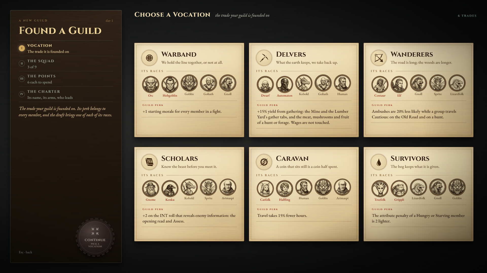
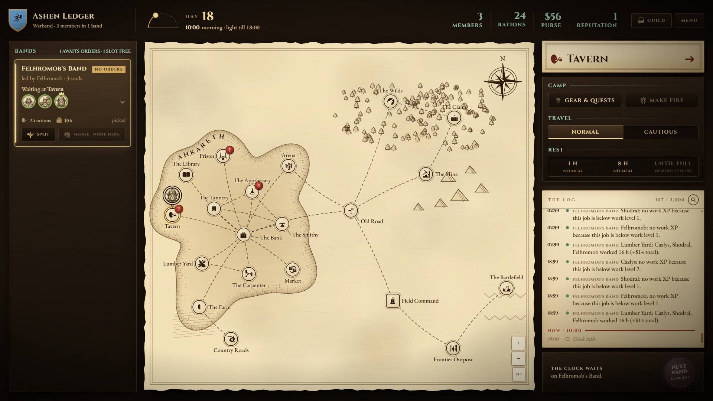
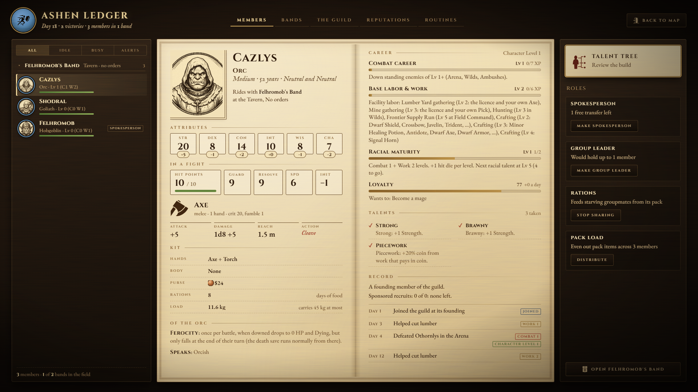
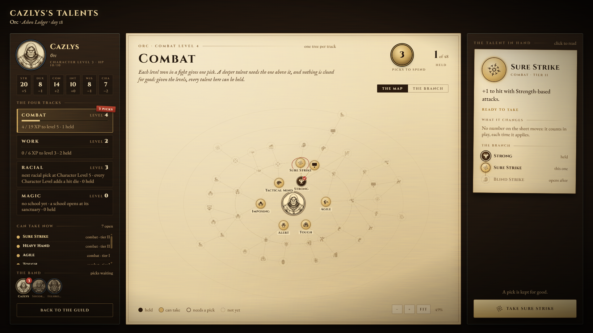
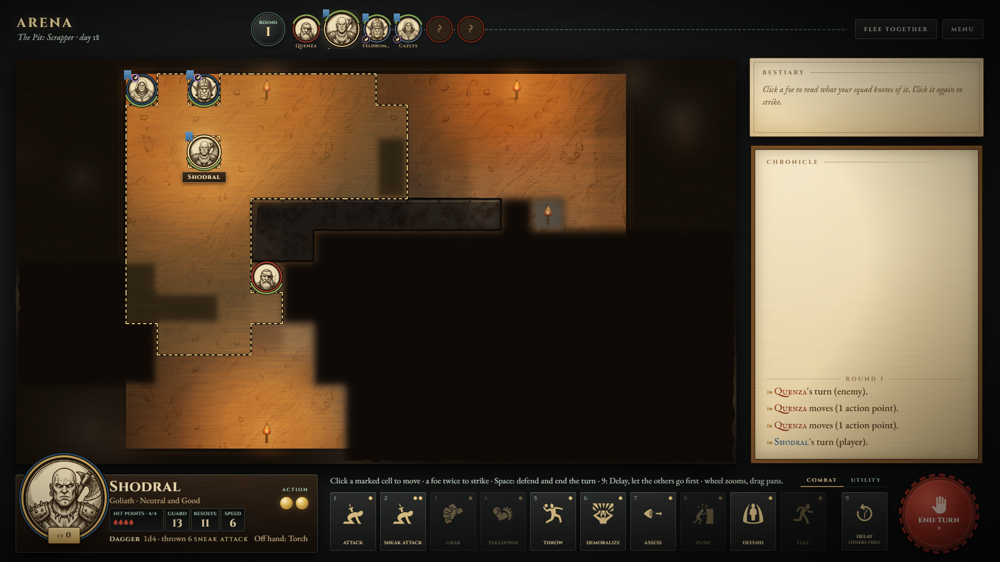

# Gartok

**Found a guild, send your band out into the world, and fight it out turn by turn.**

Gartok is a turn-based tactical strategy game mixed with guild management. You pick the trade your guild is founded on, draw your first squad, and settle into an open world: work for coin, buy and sell, recruit, travel, bet on the Arena and fight tactical battles. Every member is an individual, with a character sheet, talents, loyalty and a story the game keeps writing for them.

  <a href="../../releases/latest"><b>⬇&nbsp;&nbsp;DOWNLOAD THE LATEST VERSION (Windows)</b></a>

> Under active development. The current releases are 0.1.x: the game is playable from start to finish, but a lot still changes from one version to the next.

---

## What you do

### Found a guild

Before day one you choose the trade your guild is founded on. Each trade has five races and a perk that applies to every member: the Warband fights with higher morale, the Delvers gather more, the Wanderers suffer fewer ambushes, and so on. There are **6 trades** and **20 races**, and the draft brings one of each of your trade's races.

  

### Live in an open world

Every place on the map has its own function and its own needs, and no band can be everywhere. Travel takes hours, so a trip has to be planned: food has to be carried, packs have a weight limit, and a cautious march trades speed for fewer ambushes. What a place offers depends on what you bring to it, and the clock only moves when you tell it to.

There is no guild treasury. Money sits in the pockets of the members, so the guild is as rich as the sum of its people.

  

### Every member is a person

A character is not a token. The sheet shows attributes, gear, load, the race's own ability, loyalty and a record of everything they have done. And they grow in what they do: a member progresses in the activities they actually take part in, and every kind of activity in the game (combat, work, race, magic) has its own talent tree.

  

  

### Fight turn by turn

Battles are tactical, on a grid, with action points, weapons with traits of their own, morale, and vision per character: what your squad cannot see, the game does not show you. In the Arena you pick the bout, put up a stake and step into the Pit.

  

---

## How to play (Windows)

1. Click **[Download the latest version](../../releases/latest)** and, under *Assets*, download `GARTOK-<version>-win64.zip`.
2. Extract the zip to any folder.
3. Run `GARTOK.exe`.

The game is not code-signed. If Windows shows the SmartScreen warning, click *More info* and then *Run anyway*.

If you already have 0.1.22 or newer you do not need to download again: the title screen tells you about a new version and the *Update* button installs it for you.

### Requirements

- 64-bit Windows.
- About 210 MB to download. No installer and no account needed.
- Languages: English and Portuguese (Brazil), in Settings.

Saves live in `%APPDATA%\GARTOK`.

### Battle controls

| To | Do this |
|---|---|
| Move | Click a marked cell |
| Attack | Click the foe twice |
| Use an action | Keys **1** to **9**, or the buttons on the bottom bar |
| Defend and end the turn | **Space** |
| Delay your turn | **9** (lets the others go first) |
| Zoom and pan the field | Mouse wheel and drag |
| Go back | **Esc** |

Every new screen comes with a short in-game help card, and *Wiki & compendium* in the menu explains the rules.

---

## Feedback and bugs

Found a bug, a line that makes no sense, or a fight that feels unfair? Open an [issue](../../issues/new/choose) and tell us the version (it is on the title screen), what you were doing and, if you can, attach the zip from *Export playtest data* in Settings.

## About this repository

This repository only distributes the game: the source code is not public. Every version is on the [Releases](../../releases) tab.

The character portraits were generated with AI, in an engraving style.

## License

All rights reserved. See the [LICENSE](LICENSE) file.
