# Screenshot review, 2026-11-12

25 screenshots of GARTOK Tactical, game version 0.1.9, taken on 2026-11-12 at 1920x1080 in headless Edge. The economy and management screens come from a copy of a late-game save (day 73, guild "RecebiHeranca", 8 members in 2 bands). The battle screens come from combat-lab fights started with `python -m gartok.web --fight ...`, plus one fight played from the campaign (`battle_pit_campaign`). The shots are a dated snapshot for a Steam page review. They are not kept up to date: when the UI changes, retake them.

Each entry below judges the frame as a store-page asset, not as a UI test. One store-page consideration applies to every shot: the portraits are AI-generated engraving-style medallions. Steam asks developers to disclose AI-generated content, and the store page should say so.

Scale used for verdicts:

- `store-ready`: could go on the page as is.
- `usable with a fix`: a good frame once a named, small problem is fixed (retake or UI fix).
- `filler`: accurate but does not sell; fine as a 6th to 10th screenshot, or not at all.
- `not presentable`: do not show.

## Summary table

| File | Screen | Verdict | Reason |
|---|---|---|---|
| title.png | Title menu | usable with a fix | Strong first impression, but the save is named "GSDGDSGSD" with 3 level-0 members, day 1 |
| map.png | World map | usable with a fix | Best "this is a guild manager" image, but node labels are hidden behind tokens, lines and trees |
| guild.png | Guild, Members tab | store-ready | Dense, legible, shows depth; only the "2TH BAND" name needs care |
| bands.png | Guild, Bands tab | filler | Wall of item lists, every bar red from overload, empty lower half |
| guild_tab.png | Guild, The Guild tab | filler | Readable but half empty parchment and mostly text |
| reputations.png | Guild, Reputations tab | filler | Checklist wall, small text, empty right and lower areas |
| routines.png | Guild, Routines tab | usable with a fix | The most unusual feature on screen; needs a presentable routine name and a filled description |
| sheet.png | Character sheet over the Smithy | usable with a fix | Clean and readable, but text-heavy and it repeats the Members tab |
| talents.png | Talent tree | usable with a fix | Good idea (radial tree), but the tree is mostly ghosted and only 4 nodes are lit |
| shop.png | Smithy, Shop tab | usable with a fix | Drag-to-buy is clear, but truncated names, a clipped last row, a raw key-like tag |
| farm.png | Farm shop | filler | Two wares on the shelf, big empty parchment, many truncated names |
| forge_empty.png | Smithy, Forge tab | not presentable | Empty state: 0 crafters, 0 recipes, a blank parchment |
| arena.png | Arena bout selection | filler | Good cards, but two thirds empty and the action button is greyed out |
| draft.png | Found a guild, squad picked | usable with a fix | Appealing portrait cards and a clear loop; clipped text on cards and in the left list |
| draft_pool.png | Found a guild, nothing picked | filler | Same screen with an empty squad; the picked state is the better shot |
| charter.png | Found a guild, charter | usable with a fix | Pretty banner and shield; placeholder name "The Guild" and a clipped signature row |
| battle_open.png | Battle, open field | usable with a fix | Cleanest battle frame (no fog), but weapon line cut off and unit panel overflows |
| battle_open_zoom.png | Battle, open field, zoomed | usable with a fix | Tokens read better, but the top row is cropped and the same panel problems remain |
| battle_dungeon.png | Battle, ruins | usable with a fix | Atmospheric, but fog is a patchwork and lab metadata ("seed 5") shows |
| battle_pit.png | Battle, "Challenge the Champ" | not presentable | Worst fog patchwork, truncated title, lab metadata, remembered floor brighter than lit floor |
| battle_scrapper.png | Battle, The Pit: Scrapper (lab) | not presentable | Fog patchwork, an oversized grey token, clipped log, lab metadata |
| battle_pit_campaign.png | Battle, The Pit: Scrapper (campaign) | usable with a fix | Best combat mood (torches, warm light); fog is still blocky and one name label is covered |
| dialogue.png | Challenge dialogue over a battle | filler | A good moment, but the board behind it is almost black and the log is empty |
| report.png | After the fight, report | filler | Nice "Victory" stamp and kill graph, but half the page is empty |
| wiki.png | Compendium, Items | filler | Useful and tidy, but not a selling shot; item names show a font glitch |

## Recommended set for the Steam page today

In this order:

1. `battle_open.png`. Retake it with a unit whose HP and weapon line fit the panel. It is the only battle frame with no fog artefacts, and the colour reads well as a thumbnail.
2. `map.png`. Retake after fixing the label collisions and renaming the bands. It says "guild manager with a world" in two seconds.
3. `battle_pit_campaign.png`. The torch-lit arena has the best mood. Retake once the fog is smoothed, or crop out the dark right edge.
4. `guild.png`. Shows the depth (talents, kit, roles, careers) without a wall of empty space. Use a presentable band name.
5. `routines.png`. The visual-programming routine editor is the thing no other game has. Rename "Compra batata" to something a stranger reads.
6. `draft.png`. Portrait cards give the page a face and show where a run starts. Fix the clipped lines first.

Not on the page today: the title screen (put it in the trailer instead), anything from the lab fights with a seed in the header, `forge_empty`, `bands`, `reputations`.

Moments that would make a short GIF (about 6 to 10 seconds each, 1920x1080, no seed in the header):

- A move with the dashed path preview, then a double click to strike, then the hit line appearing in the Chronicle (use the campaign pit fight, torch light visible).
- A band travelling on the map: the blue dashed route, the clock advancing, the log filling in.
- Dragging a ware from the shelf onto a shopper in the shop; the pack and purse update.
- Dropping a block into a routine and the list reflowing.
- The Victory stamp landing on the report, then the kill graph drawing itself.
- Zooming into the talent tree and clicking a node.

---

## title.png

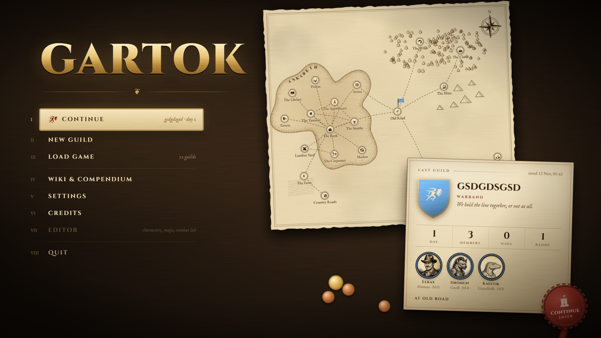

**What it shows**: The title menu with the GARTOK logo, a parchment map of Ankareth and a "Last guild" card with a Continue seal.

**Commercial read**: This is the strongest first impression of the set. The gold logo, the dark wood, the parchment map and the wax seal say "fantasy, hand-made, management" at once. A stranger would stop on it, but a title screen is a poor store screenshot: it shows no play. It looks finished.

**Errors**:
- The last guild is "GSDGDSGSD" (also shown lowercase in the Continue row as "gsdgdsgsd"), with 3 level-0 members, 0 wins, day 1. It reads as keyboard mash.
- Bottom right of the map: a node (at about x=1590, y=500) is half hidden behind the Last guild card.
- The logo says "GARTOK" while the compendium header says "GARTOK Tactical"; pick one for the store page.
- The Editor row is greyed out with no hint why.

**Improvements**: Shoot it from a save with a real guild name and a late-game roster, so the card shows wins and a full band. Keep it for the trailer opening or as a page header, not as screenshot 1.

## map.png

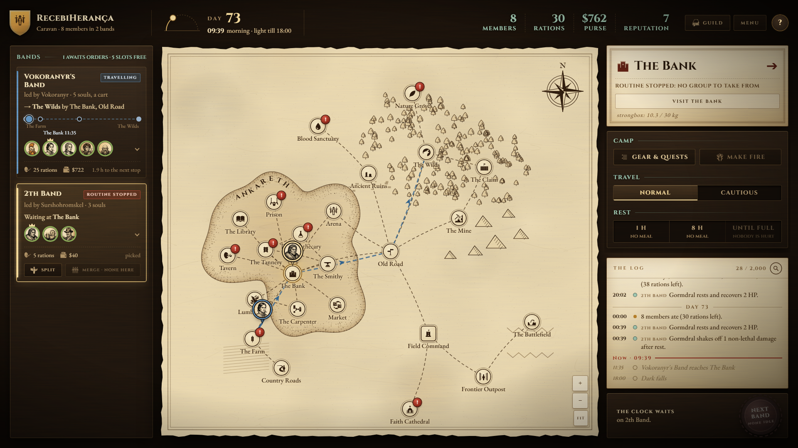

**What it shows**: The world map on day 73, two bands listed on the left, the bank selected on the right, the log bottom right.

**Commercial read**: A stranger scrolling would stop here. The hand-drawn parchment, the compass and the dashed routes look like a finished indie strategy game, and the side panels show real systems (bands, rations, travel, rest, log). In two seconds it says: you manage groups moving across a world. The red "!" badges (intentional) show there is plenty to do.

**Errors**:
- Labels hidden behind band tokens: "Lumber Yard" reads "Lumi" (left of the blue token at x=630, y=750), "The Apothecary" reads "thecary" (x=750, y=595), "The Tannery" is partly covered by the selected token.
- Labels crossed by lines and trees: "Field Command" has a dashed route through it (x=1030, y=834), "Nature Grove" is under tree icons (x=1015, y=255), "Blood Sanctuary" has a dashed line through it, "The Wilds" and "The Claim" sit on trees.
- The left Bands panel is empty below the second band (about 40 percent of the column).
- The right card says "ROUTINE STOPPED: NO GROUP TO TAKE FROM", which reads as an error message to a newcomer.
- "2TH BAND" is a player-typed name (known, not a bug).
- The "NEXT BAND" button bottom right is faint and its caption "HOME IDLE" is tiny.

**Improvements**: Give label text a parchment halo or draw labels above tokens; move the band token off the label. Retake with presentable band names and with the camera on the busiest area. Zoom slightly so the map fills the frame without the dead margin on the right.

## guild.png

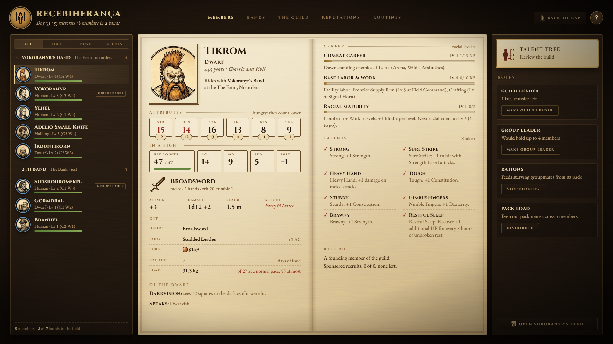

**What it shows**: The Members tab: roster on the left, Tikrom's character sheet in the middle (attributes, fight stats, kit, talents, career), roles and actions on the right.

**Commercial read**: It looks like a finished management game: a book-style sheet, portraits, readable numbers. A stranger would read it as "deep RPG character management", which is the right promise. It is not flashy, but it is the cleanest dense screen.

**Errors**: none seen in the frame itself. Minor: the lower 15 percent of the sheet and the right column are empty; "Sponsored recruits: 0 of 0: none left." reads awkwardly; "2TH BAND" is a player-typed name (known).

**Improvements**: Use a presentable band name. Pick a member with more talents and gear so the sheet is fuller. A caption on the store page would help, because the numbers are small at thumbnail size.

## bands.png

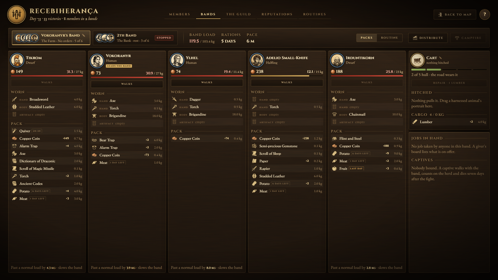

**What it shows**: The Bands tab: five character columns with worn gear and pack lists, plus a cart column.

**Commercial read**: A wall of small text. It shows that the game has real inventory and weight, but a stranger sees a spreadsheet. Every load bar is red and the header says band load 119.5 / 103.4 kg, so the shot reads as "the player is failing". It does not look broken, but it does not sell.

**Errors**:
- Cart panel: "CARGO 4 / 0 KG" with a 4 kg load against 0 capacity looks like a bug.
- Each column's lower half (from about y=780) is empty, and the footer "Past a normal load by 4.3 kg" sits alone at the bottom.
- "2TH BAND" is a player-typed name (known).
- Several items have faint tags ("6 DAYS LEFT", "1 DAY LEFT") at a size that will not read on Steam's thumbnail.

**Improvements**: Not a screenshot candidate. If kept, shoot a lighter-loaded band (green bars) with fewer, more interesting items.

## guild_tab.png

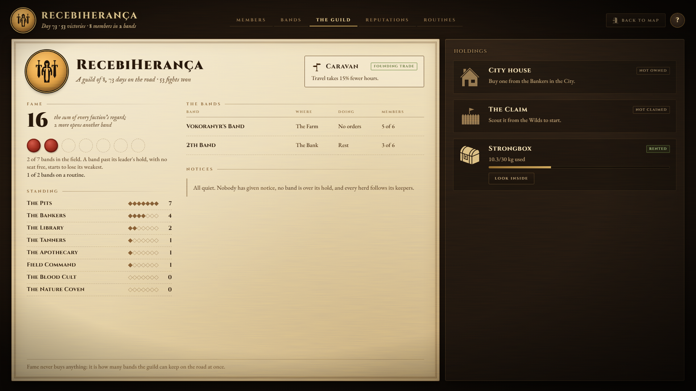

**What it shows**: The guild sheet: fame, standing with eight factions, the bands table, holdings (city house, claim, strongbox).

**Commercial read**: Readable and nicely typeset, and it hints at a faction and holdings layer. But it is mostly text and diamonds; nothing makes a stranger stop. It looks finished.

**Errors**:
- The parchment is about 40 percent empty below the standing list and under "Notices" ("All quiet...").
- The right Holdings column is empty below the strongbox.
- "2TH BAND" is a player-typed name (known).
- Two of the three holdings read "NOT OWNED" / "NOT CLAIMED", so the shot shows what the player lacks.

**Improvements**: Shoot it after the guild owns a house and a claim, with a notice in the box. Otherwise leave it out.

## reputations.png

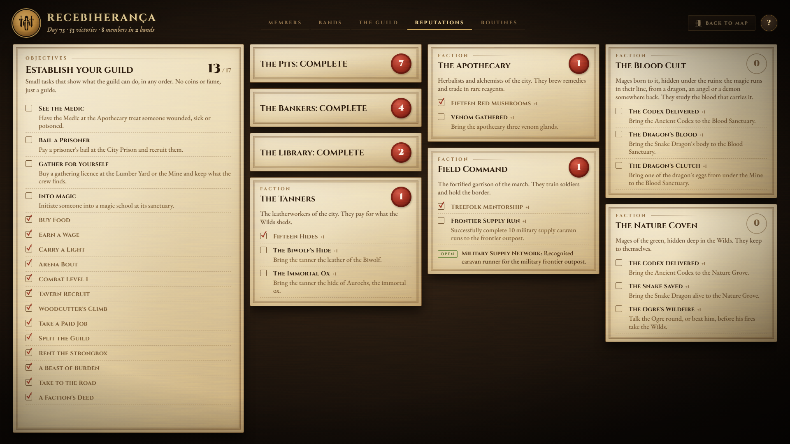

**What it shows**: Objectives (13 of 17 done) and one card per faction with its tasks.

**Commercial read**: It communicates "there are factions and long-term goals", but as a checklist wall in small type it does not pull the eye. A stranger would not stop. It looks finished.

**Errors**:
- The right half and the bottom of the page are empty dark space under the shorter faction cards.
- Faction cards have uneven heights, so the columns look ragged.
- Description text is about 13 px; unreadable at thumbnail size.
- The "Frontier Supply Run" card shows an "OPEN" tag and a long sentence that wraps awkwardly under it.

**Improvements**: Filler at best. If kept, shoot it with more factions unlocked so the grid is full.

## routines.png

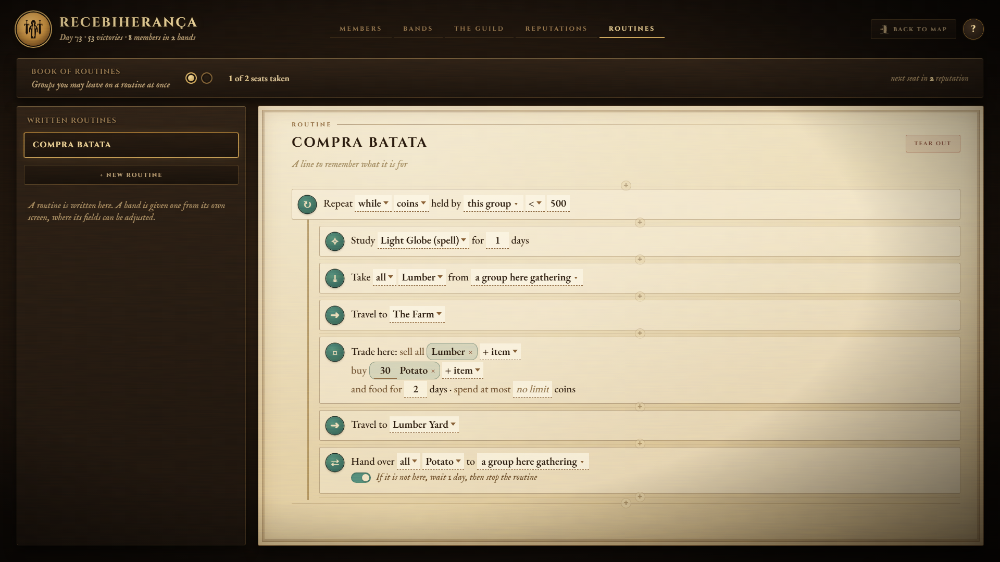

**What it shows**: The routine editor: a block program (repeat while, study, take, travel, trade, hand over) with dropdown fields.

**Commercial read**: This is the most distinctive image of the set. A visual script that runs a trading band by itself says "automation game" and is a real hook for the management audience. It looks finished and clean. The Portuguese name "COMPRA BATATA" and the potato trade make a stranger smile, but also make it look like a test file.

**Errors**:
- Placeholder text in the description field: "A line to remember what it is for".
- The bottom of the parchment (below y=980) is empty, and the left list holds a single routine over a mostly empty column.
- The "+" insert handles between blocks are faint and sit on the block borders.
- The right-hand side of every block row is empty (the blocks are very wide for their content).

**Improvements**: Rename the routine and the guild to presentable English, write a description, and use a routine with two or three clearly named steps. This is a candidate for a GIF (drag a block in, run it).

## sheet.png

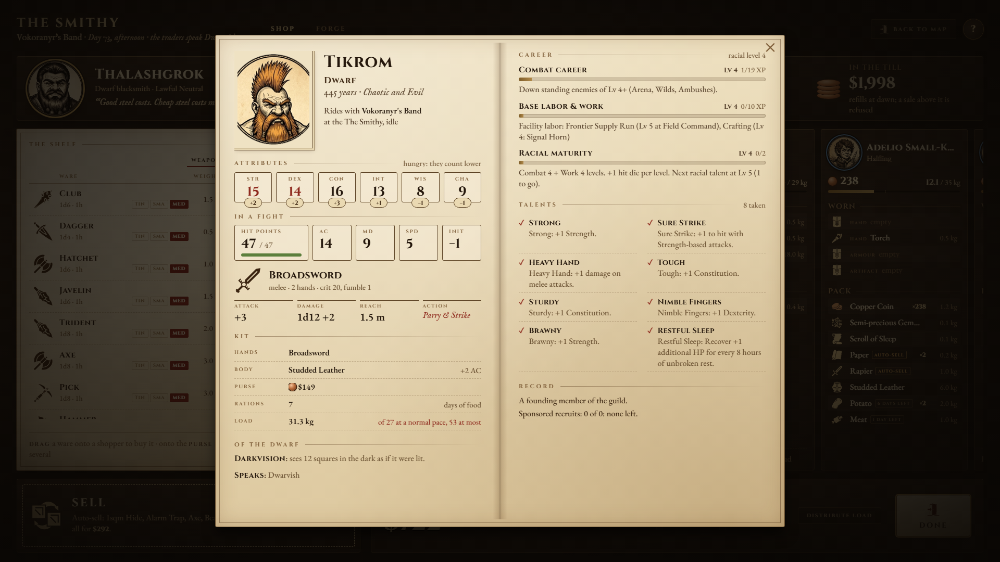

**What it shows**: Tikrom's character sheet as a modal over the dimmed Smithy.

**Commercial read**: The sheet itself is good-looking, but it is the same content as `guild.png`, so it adds nothing as a second shot. The dimmed shop behind it looks muddy. A stranger sees "lots of numbers".

**Errors**:
- The sheet duplicates `guild.png`.
- The right column is empty below "Record" (about 25 percent of the page).
- Behind the modal, the shelf and the right columns are dimmed but still half visible, which clutters the edges.

**Improvements**: Use one of the two. If this modal is the one kept, open it over the map, not over the shop.

## talents.png

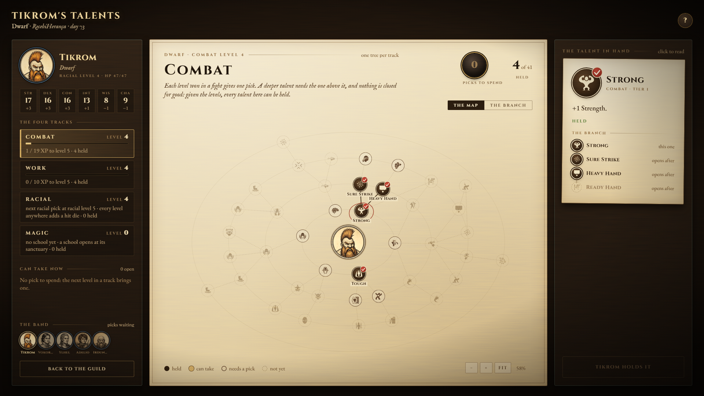

**What it shows**: Tikrom's Combat talent tree as a radial map, with the selected talent "Strong" and its branch on the right.

**Commercial read**: A radial tree is a strong, recognisable promise ("build your character"), and the frame looks finished. But the tree is faded to near invisibility: only 4 nodes are lit out of 41, so a stranger sees a pale map of ghost icons. The message "you choose how each person grows" is lost.

**Errors**:
- Most nodes and links are very low contrast and unreadable at this size.
- Labels "Sure Strike" and "Heavy Hand" sit almost on each other (x=980 to 1080, y=530 to 545).
- The left panel has "No pick to spend" and "0 open", and the button reads "TIKROM HOLDS IT" and is disabled: the screen is in a dead-end state.
- Large empty area top-left and bottom of the parchment.
- Attributes here read STR 17 / DEX 16 / CON 16; the sheet in `guild.png` and `sheet.png` reads STR 15 / DEX 14 / CON 16 for the same unit. If talent bonuses explain it, say so on screen; otherwise it is an inconsistency.

**Improvements**: Shoot a character with picks to spend, 15 to 20 nodes lit and one node highlighted as "can take". Raise the contrast of the unlit nodes. Good GIF candidate (zoom and click).

## shop.png

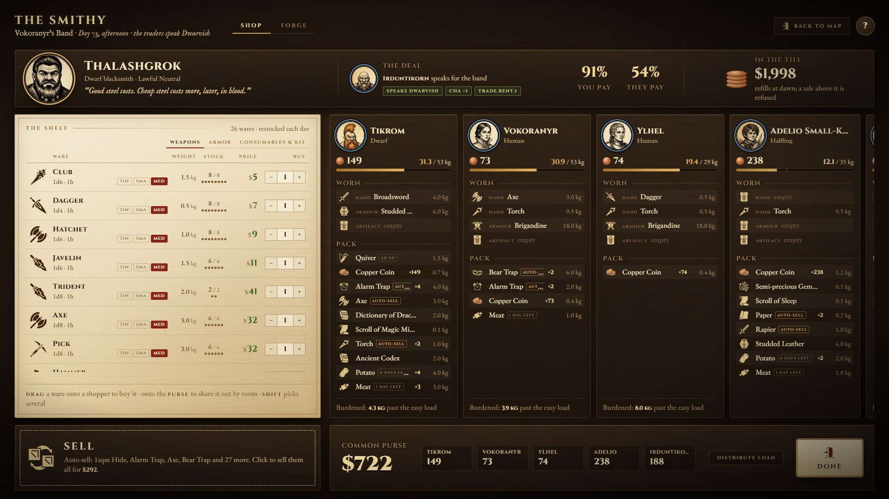

**What it shows**: The Smithy: shelf of weapons on the left, the band's members with kit and purses on the right, a sell zone and a common purse below.

**Commercial read**: It is a lot of interface, but the idea (drag a ware onto a person) is clear and the layout is tidy, with a nice smith portrait. A stranger would read "shopping and inventory management with prices and haggling". It looks mostly finished, though dense.

**Errors**:
- Truncated names with an ellipsis: "Studded ...", "Dictionary of Drac...", "Scroll of Magic Mi...", "Adelio Small-K...", "Irduntiko...", "Potato 6 DAYS LE...", "Alarm Trap AUT...".
- The last shelf row ("Hammer") is cut in half at the bottom of the shelf (x=130, y=800).
- A fifth shopper is cut off by the right screen edge (slivers at x=1860).
- The tag "TRADE.BENT.1" in the deal strip looks like an untranslated key, not a label.
- Each member's pack is long and the bottom items are cut by the "Burdened" footer.
- Large empty gap in the Vokoranyr and Ylhel columns below their packs.

**Improvements**: Fix the truncations (wider columns, or smaller type for long names), show a full row at the shelf end, and give the deal tag a readable name. A GIF of one buy (drag, price tick, purse update) would work.

## farm.png

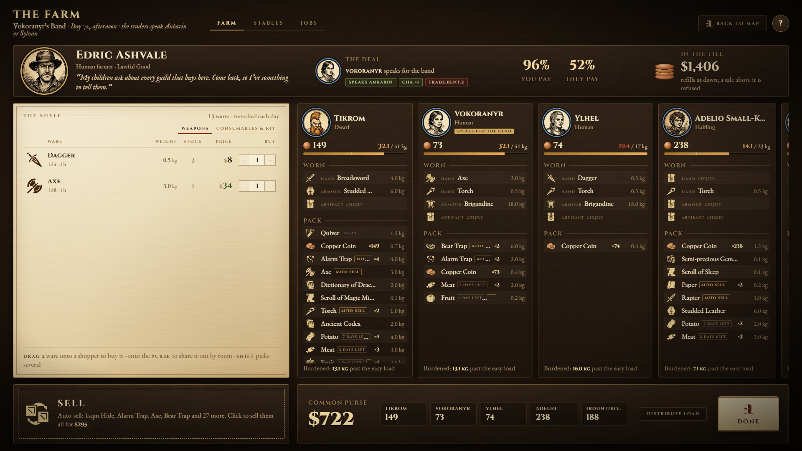

**What it shows**: The Farm shop, the same layout as the Smithy, with only a Dagger and an Axe on the shelf.

**Commercial read**: A farm that sells weapons, with an almost empty shelf, looks unfinished. The farmer's portrait and the quote are good, but a stranger sees mostly empty space and truncated text. It is the same layout as `shop.png` with less to see.

**Errors**:
- The shelf shows 2 wares in a parchment that fits about 13, so more than 70 percent of it is blank.
- The header says "Day 72" while every other shot in this folder says day 73.
- Truncated names: "Studded ...", "Dictionary of Drac...", "Scroll of Magic Mi...", "Adelio Small-K...", "Irduntiko...", "Fruit 1 DAY LEFT ..." with an empty box next to it.
- The bottom row of Tikrom's pack ("Fruit") is cut at y=865.
- A fifth shopper is cut off by the right screen edge.
- Weight reads "32.1 / 41 kg" here and "31.3 / 53 kg" in the Smithy for the same unit; that may be a cart effect, but nothing explains it.

**Improvements**: Open it on the Consumables tab with food on the shelf, or drop it. Do not use it next to `shop.png`.

## forge_empty.png

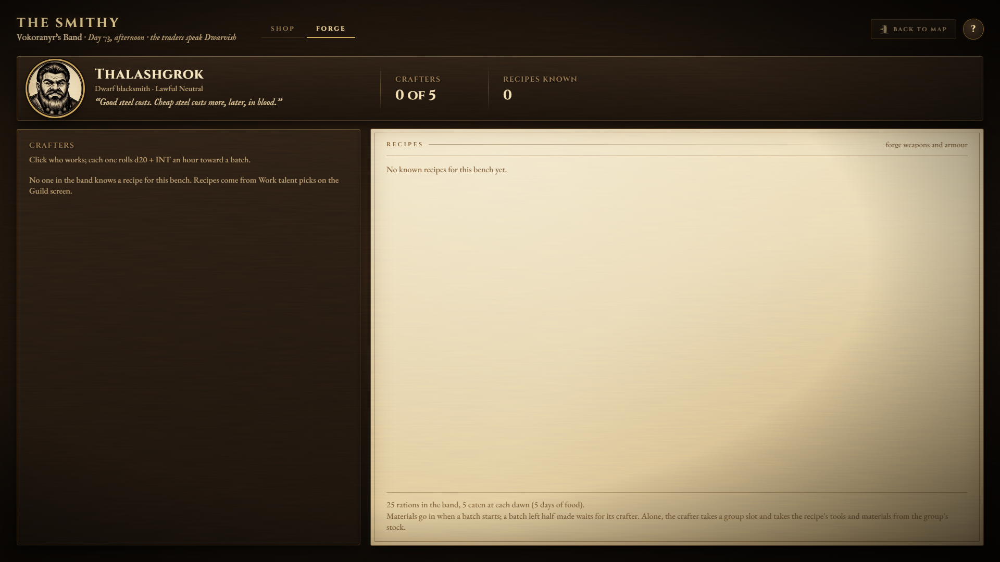

**What it shows**: The Forge tab with no crafters and no recipes.

**Commercial read**: A stranger sees a blank page with two lines of help text. It reads as an unfinished screen. It says nothing about crafting.

**Errors**:
- The recipes parchment is blank apart from "No known recipes for this bench yet." (about 90 percent empty).
- The crafters column is blank apart from two lines.
- "CRAFTERS 0 OF 5" and "RECIPES KNOWN 0" put the empty state in the header.
- The recipes panel has a visible light/dark gradient on the right half.

**Improvements**: Do not use. Shoot the Forge with known recipes, a crafter assigned and a batch in progress; that would be a good shot.

## arena.png

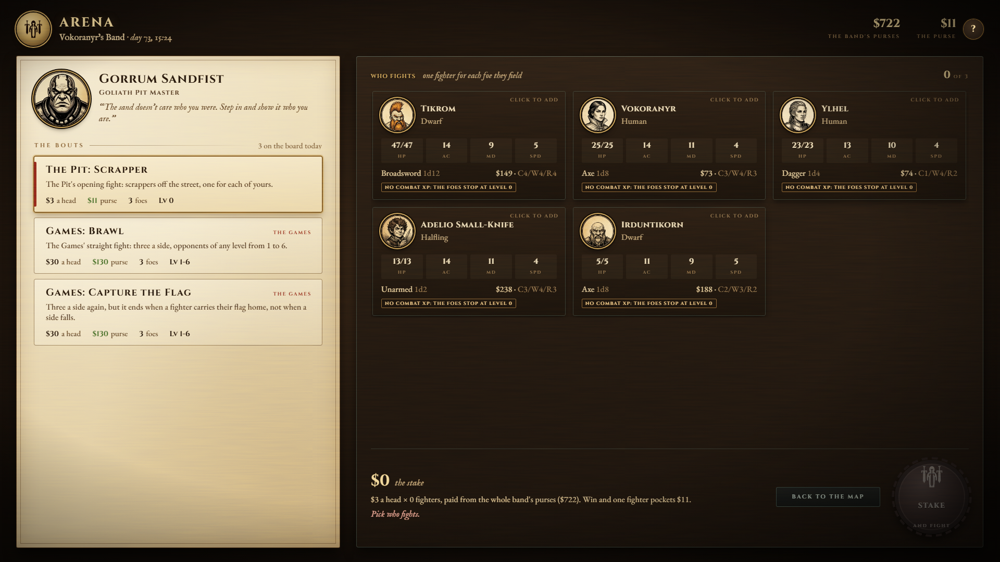

**What it shows**: The Arena: bout list on the left (Pit and two Games), the band's fighters on the right, stake and fight button below.

**Commercial read**: The portraits and stat tiles are attractive, and the idea (stake money, pick fighters) is clear. But the frame is two thirds empty, the Stake button is greyed out and the stake reads "$0". A stranger sees an empty form. It looks finished, but not alive.

**Errors**:
- The left bout list ends at y=660 and the parchment is blank below.
- The right panel is blank between the fighter cards and the stake row (about y=620 to 860).
- Fighter cards show the cryptic tags "C4/W4/R4", "C3/W4/R3" with no legend.
- "STAKE AND FIGHT" is disabled and its second line is nearly invisible.
- Each card repeats "NO COMBAT XP: THE FOES STOP AT LEVEL 0" in a tiny tag.

**Improvements**: Shoot with three fighters picked (the stake filled in and the button lit) and a Games bout selected. Fewer repeated tags.

## draft.png

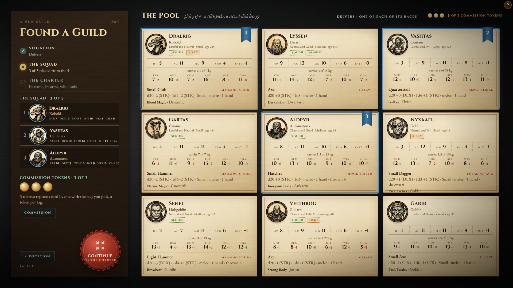

**What it shows**: The new-guild draft: nine candidate cards, three picked and numbered with ribbons, the chosen squad on the left.

**Commercial read**: This is a good "start of a run" shot. The portrait cards with ribbons look like a finished product and show variety (kobold, centaur, automaton, goblin). A stranger gets "pick your own odd crew". The stats are dense, but the card layout carries it.

**Errors**:
- Nyxkael's card: the last line "Pack Tactics · Goblin" is cut by the card's bottom border (x=1455, y=716).
- Left squad list: the CHA value is cut at the panel edge ("CHA 1" for Vashtas, "CHA 10" touching the edge for Aldpyr).
- Race lines have a dangling separator ("Kobold ·", "Centaur ·", "Goblin ·"): an empty field between two dots.
- Garir has 1 HP and Dralrig 5 HP; the 3 and 1 HP cards look broken to a newcomer.
- The vocation, squad and charter steps are small and the Continue seal is large; the hierarchy is slightly off.

**Improvements**: Fix the clipped text and the empty-field separators. Use this one rather than `draft_pool.png`.

## draft_pool.png

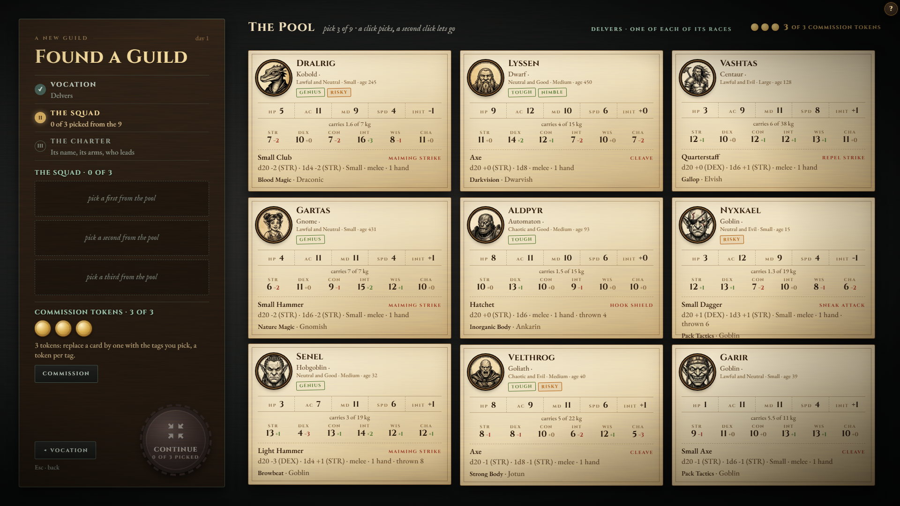

**What it shows**: The same draft screen with no pick made.

**Commercial read**: Same layout, less appeal: the left panel shows three dashed empty slots and a greyed Continue button. It reads as "unstarted". Use `draft.png` instead.

**Errors**:
- Same clipped line on Nyxkael's card ("Pack Tactics · Goblin", x=1455, y=716).
- Same dangling separators after race names.
- Three empty slots and a disabled Continue seal dominate the left column.

**Improvements**: Drop it from the page, or keep it only as a source for the GIF's first frame (click a card, ribbon drops in).

## charter.png

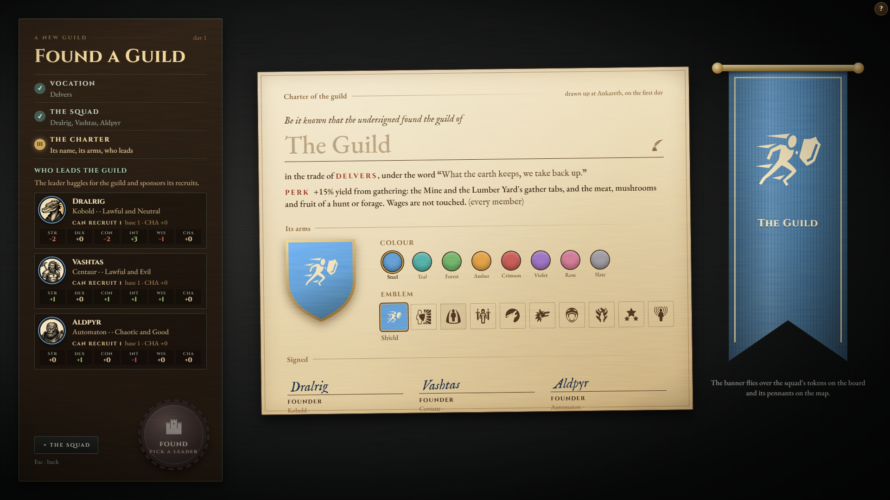

**What it shows**: The charter step: a charter scroll with the guild name, vocation, perk, colour and emblem pickers, three founders' signatures, and a banner preview.

**Commercial read**: It looks charming and finished: the scroll, the shield and the hanging banner are the most "designed" frame in the set. A stranger gets "you build your own guild identity". But the name field holds the grey placeholder "The Guild" and the Found button is disabled ("PICK A LEADER").

**Errors**:
- The signature row is cut at the bottom of the parchment: the race lines under the founders ("Kobold ·", "Centaur ·", "Automaton ·") are half hidden (y=880 to 890).
- The scroll is rotated slightly and its frame clips against the bottom edge.
- "The Guild" is placeholder text, not a name.
- The perk line wraps to two long lines of small type.
- Large empty dark area at the right under the banner.

**Improvements**: Type a real name, pick a leader (button lit), choose a colour that is not the default. Fix the signature clipping.

## battle_open.png

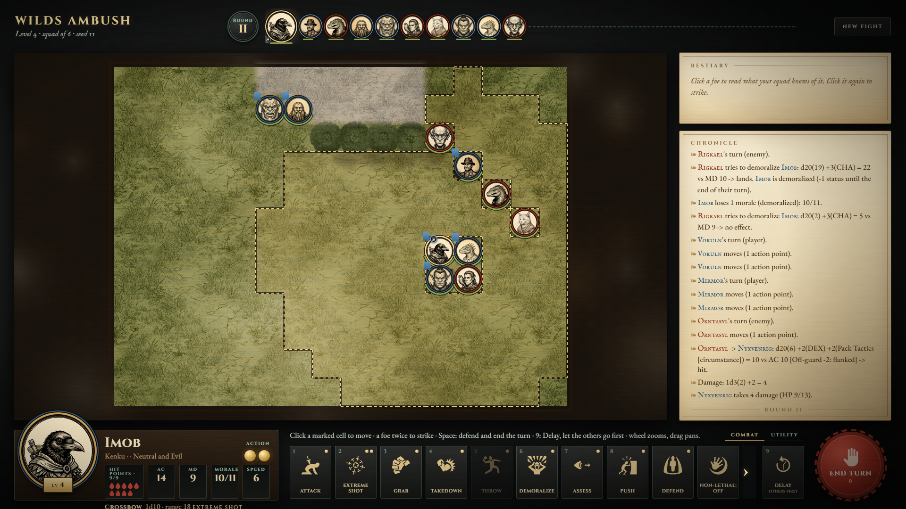

**What it shows**: A "Wilds Ambush" fight on an open grass field with the full UI around it.

**Commercial read**: The cleanest battle frame: bright green, readable tokens, a clear move range in dashes and a full action bar. A stranger gets "turn-based tactics with action points". It looks like a finished UI. The board is flat, with little to look at beyond the tokens, and the field only fills about 55 percent of the board area.

**Errors**:
- The weapon line at the bottom of the unit panel ("CROSSBOW 1d10 · range 18 EXTREME SHOT") is cut off by the bottom of the screen (y=1075).
- In the unit panel, "HIT POINTS · 9/9" wraps to three lines and the blood-drop pips fill the box to its lower edge.
- The header shows lab metadata: "Level 4 · squad of 6 · seed 11" and a "NEW FIGHT" button.
- The race line reads "Kenku · · Neutral and Evil" with a doubled separator.
- The Bestiary panel shows only the help sentence, taking about a sixth of the right column.
- Large dark margins on the left and right of the field.

**Improvements**: Retake with the panel fixed and the lab header replaced by a real mission title. Zoom in so the board fills the frame (see `battle_open_zoom.png`), and shoot mid-fight with a hit line in the log and a target selected.

## battle_open_zoom.png

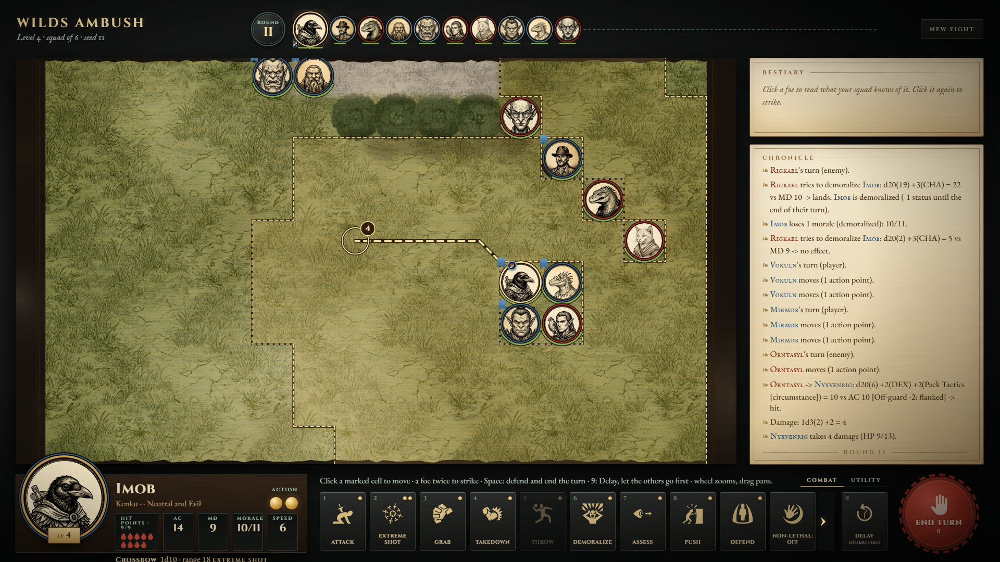

**What it shows**: The same fight with the camera zoomed in and a movement path previewed (a 4-step path).

**Commercial read**: Better than the wide shot: bigger tokens and a visible path with its cost badge. A stranger reads the movement system at once. It still looks like a UI test frame because of the lab header.

**Errors**:
- The top row of tokens is cropped by the board edge (the orc and the dwarf at y=115 to 180 are cut).
- The board edge is a torn-paper strip that now sits on top of the tokens (y=115).
- The unit panel problems remain: weapon line cut at the bottom ("CROSSBOW 1d10 ..."), "HIT POINTS · 9/9" wraps and the pips fill the box to the edge.
- Lab metadata in the header ("seed 11") and "Kenku · · Neutral" doubled separator.

**Improvements**: Zoom to frame the action, not the empty grass: centre on the group of tokens and keep all of them inside the board. Fix the unit panel.

## battle_dungeon.png

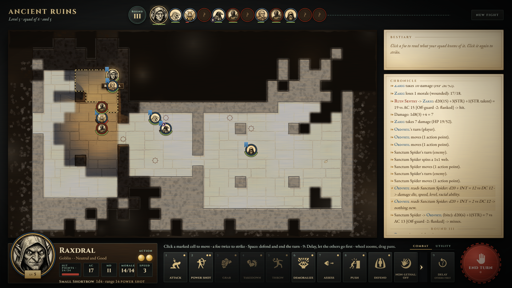

**What it shows**: An "Ancient Ruins" fight in a stone dungeon with torch light, fog of war and a long turn order.

**Commercial read**: The warm torch pool against dark stone is atmospheric and says "dungeon crawl". A stranger would stop on it more than on the grass field, if the fog looked right. As it is, the black and white blocks look like a rendering bug, not a design.

**Errors**:
- Fog of war is a patchwork of dark and light squares; remembered floor (bright white-grey) is brighter than the torch-lit floor (brown) on the left.
- A name label is covered: the label under the token at (420, 320) reads "R...L".
- The turn order has four "?" tokens (unknown units), which reads as missing art.
- The unit panel: "HIT POINTS · 24/24" wraps to three lines, and the weapon line "Small Shortbow" touches the bottom of the screen.
- The first line of the Chronicle is cut at the top ("ZARIG takes 10 damage (HP 26/52).") and the last entry is cut under "ROUND III".
- Lab metadata in the header: "Level 5 · squad of 6 · seed 5", "NEW FIGHT".
- "Goblin · · Neutral and Good": doubled separator.

**Improvements**: Smooth the fog (blur the cell edges or draw remembered floor darker than lit floor), then retake. Use a mission name in the header.

## battle_pit.png

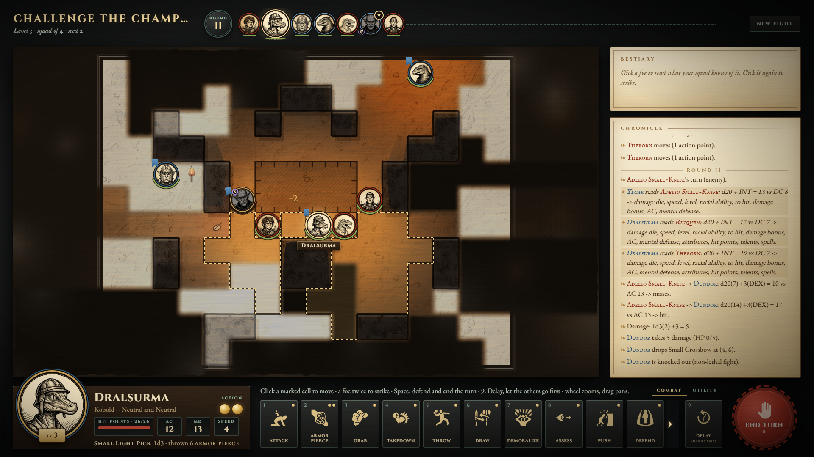

**What it shows**: A pit fight titled "CHALLENGE THE CHAMP..." with a torch-lit arena and fog.

**Commercial read**: This is the frame where the fog problem is worst. The brown torch light is split by white and black blocks that read as a corrupted texture, and the arena looks broken rather than moody. A stranger would think it unfinished.

**Errors**:
- The title is truncated: "CHALLENGE THE CHAMP..." with an ellipsis.
- The fog is a patchwork of dark and light squares; remembered floor is brighter than lit floor (large white and grey blocks next to the brown lit area).
- The "-2" on the brown rectangle in the centre has no explanation and looks like debug text.
- The name tooltip "DRALSURMA" sits on a token and hides the neighbouring one.
- The Chronicle starts mid-line at the top ("THERON moves (1 action point)." cut in half).
- Lab metadata: "Level 3 · squad of 4 · seed 2".
- "Kobold · · Neutral and Neutral": doubled separator.

**Improvements**: Not presentable until the fog is fixed. After that, a short mission title and no seed.

## battle_scrapper.png

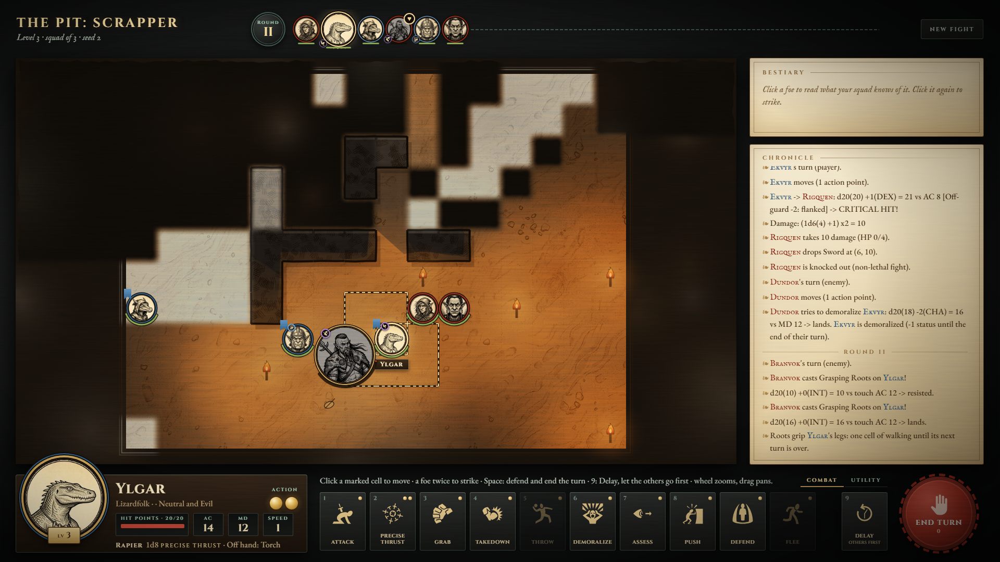

**What it shows**: The Pit: Scrapper as a combat-lab fight, mid-round, with a rapier user selected.

**Commercial read**: Same issue as `battle_pit.png`: the lit area is good, but the black and white fog blocks at the top and left ruin the frame. The large grey token in the middle is confusing: it is bigger than the others and has no coloured ring, so it looks like a leftover asset.

**Errors**:
- Fog patchwork of white and black squares across the top half; remembered floor is brighter than lit floor.
- A large token (about 140 px) in the grey engraving style sits over three smaller tokens, with a different ring from every other token (no blue or red ring).
- The first Chronicle line is cut at the top ("EKVYR s turn (player)." half hidden), and the "s" appears detached from the name.
- Lab metadata: "Level 3 · squad of 3 · seed 2" and "NEW FIGHT".
- "Lizardfolk · · Neutral and Evil": doubled separator.

**Improvements**: Same as `battle_pit.png`. If the grey token is a large creature, give it the same ring colour as its side and a label.

## battle_pit_campaign.png

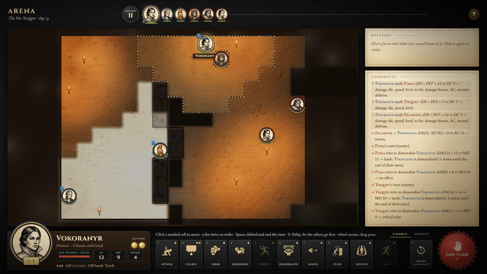

**What it shows**: The same pit fight started from the campaign, so the header says "ARENA · The Pit: Scrapper · day 73", with torches and a selected move range.

**Commercial read**: The best combat frame. The warm sand, the torches and the dashed move area read as a finished arena, and the campaign header is a real mission title rather than lab data. The fog is still visible but milder, because the unlit side is mostly orange. A stranger would stop on it.

**Errors**:
- Fog still has hard square edges: a white block of remembered floor on the left (brighter than lit floor) and black rectangles in the middle and at the right edge (x=1150 to 1200).
- The name label "VOKORANY" is cut off by the enemy token next to it (x=760 to 850, y=220).
- The right 15 percent of the board and the left 5 percent are black margin.
- The Chronicle repeats three "reads" entries (Vokoranyr reads Pyrka, Tikquen, Felashtik) with long lists in a row, which is noisy.
- The unit panel is fine here: "HIT POINTS · 25/25" does not wrap.

**Improvements**: Fix the fog edges, crop the black margin, and shoot a round with a hit and damage in the log instead of three assess lines.

## dialogue.png

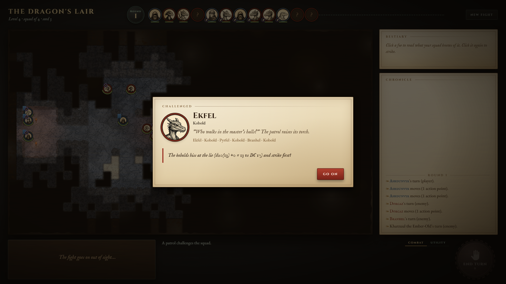

**What it shows**: A "Challenged" dialogue with a kobold patrol, over a dark dungeon board at round I.

**Commercial read**: The dialogue card is attractive (portrait, quote, a red "Go on" button) and shows the game has story beats. But everything behind it is almost black, the Chronicle is empty and the action bar is replaced by "The fight goes on out of sight...". A stranger sees a dark screen with a pop-up. It does not sell combat.

**Errors**:
- The board behind the dialogue is near black, with the fog blocks still visible as noise.
- The Chronicle is empty except for the last lines; the bottom-left unit panel is a dark empty box.
- The quote opens with a closing quotation mark ("”Who walks in the master's halls?”").
- The turn-order strip has two "?" tokens.
- Lab metadata: "Level 4 · squad of 4 · seed 3", "NEW FIGHT".
- The End Turn button is faded to near invisible.

**Improvements**: Use a brighter board, or crop to the card. A GIF of the dialogue opening into the fight could work.

## report.png

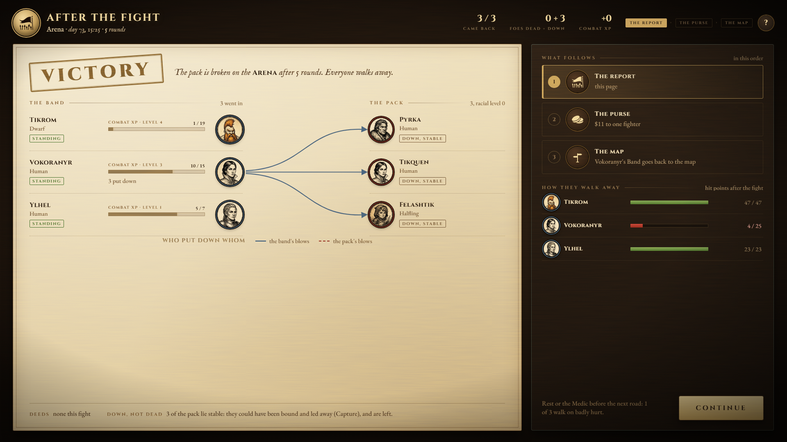

**What it shows**: The after-fight report: a "VICTORY" stamp, who put down whom, XP bars, and the follow-up steps.

**Commercial read**: The stamp and the blow-graph are nice touches and the screen looks finished. A stranger reads "combat has consequences and the game keeps score". But the left page is about half empty and the information is small. It works better as a GIF end card than as a still.

**Errors**:
- The lower half of the left parchment is empty (from y=600 to 980).
- The right panel is empty from y=640 to 950.
- The "+0" combat XP in the header and "0 + 3 foes dead + down" read as nothing happened.
- Vokoranyr's HP bar is nearly empty (4 / 25), which looks like a bad outcome next to "Victory".
- The lines of the graph all start from one portrait, which makes it look like one fighter did everything.

**Improvements**: Shoot a fight with deaths, loot and XP gain so the page is fuller. Good GIF end card.

## wiki.png

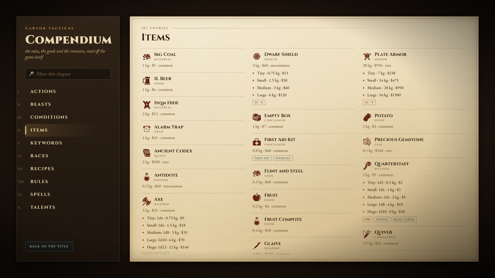

**What it shows**: The Compendium, Items chapter: a 3-column list of items with weights, prices and sizes.

**Commercial read**: Tidy, readable, nice icons. It proves the game has depth (107 items, size variants) but it is a reference page, not a selling frame. It looks finished.

**Errors**:
- Item names starting with a number are rendered in the display font so that "1kg Coal" reads "Ikg Coal", "1l Beer" reads "Il Beer" and "1sqm Hide" reads "Isqm Hide".
- The first column's last entries are cut at the bottom of the parchment ("Axe" size list, "Glaive" half visible, y=985).
- The third column ends early, leaving an empty block at the bottom right.

**Improvements**: Rename or restyle the digit-led item names, and filter them from the top of the list. Keep the wiki for a "Features" bullet, not as a screenshot.

---

## Cross-cutting problems

1. **Fog of war rendering.** In `battle_dungeon`, `battle_pit`, `battle_scrapper`, `battle_pit_campaign` and `dialogue` the unseen and remembered cells are hard-edged squares, and remembered floor is brighter than lit floor. This is the single biggest thing keeping the combat shots from store quality.
2. **Unit panel overflow.** "HIT POINTS · n/n" wraps into three lines and the pips fill the box in `battle_open`, `battle_open_zoom` and `battle_dungeon`; the weapon line is cut by the screen bottom in `battle_open` and `battle_open_zoom` and touches it in `battle_dungeon`.
3. **Lab metadata in the header.** "Level N · squad of N · seed N" and a "NEW FIGHT" button show in every lab battle (`battle_open`, `battle_open_zoom`, `battle_dungeon`, `battle_pit`, `battle_scrapper`, `dialogue`). Store shots should come from a campaign fight, like `battle_pit_campaign`.
4. **Truncated and clipped text.** Truncated names with an ellipsis in `shop` and `farm`; a half-cut last row in `shop`, `farm`, `wiki`; cut lines in `draft` and `draft_pool` (Nyxkael's card) and `charter` (signature row); a cut title in `battle_pit`; the Chronicle starting mid-line in `battle_dungeon`, `battle_pit` and `battle_scrapper`; a fifth shopper sliced by the screen edge in `shop` and `farm`.
5. **Empty space.** Large blank parchment or dark areas in `arena`, `forge_empty`, `bands`, `guild_tab`, `reputations`, `report`, `farm`, `routines` and the left Bands panel in `map`. The screens look finished in structure but unfilled in content because the save or the state is thin.
6. **Empty states shot as screenshots.** `forge_empty` (no recipes), `draft_pool` (no pick), the Arena with 0 fighters, the talent screen with 0 picks, the Farm with 2 wares. Pick states where the screen is in use.
7. **Dangling separators in the race line.** "Goblin · · Neutral and Good", "Kenku · · Neutral and Evil", "Lizardfolk · · Neutral and Evil", "Kobold ·" on the cards: an empty field between two dots, in the battle panel, the draft and the charter.
8. **Names that undermine the shot.** The guild "RecebiHeranca", the band "2TH BAND", the routine "Compra batata" and the title save "GSDGDSGSD" need presentable names before any store shot (known; listed here so the retake pass covers them).
9. **Raw or unclear labels.** "TRADE.BENT.1" and "TRADE.BENT.2" in the shop and farm deal strips look like untranslated keys; "C4/W4/R4" on the Arena cards and "CARGO 4 / 0 KG" in the Bands tab have no explanation; "ROUTINE STOPPED: NO GROUP TO TAKE FROM" on the map reads as an error.
10. **Small type.** Much of the secondary text is 11 to 13 px at 1920x1080. On a Steam thumbnail it is not legible, so the shot has to read from layout, portraits and colour alone.
11. **Consistency between shots.** The Farm header says day 72 while the rest says day 73; the same unit shows STR 17 in `talents` and STR 15 in `guild`/`sheet`; weight capacity differs between the Smithy and the Farm (53 kg and 41 kg). Retake from one save state so the numbers agree.
12. **Token and label collisions on the board and the map.** Name labels covered by tokens (`battle_dungeon`, `battle_pit_campaign`, `map`), a large grey token over smaller ones in `battle_scrapper`, and an unexplained "-2" in `battle_pit`.
