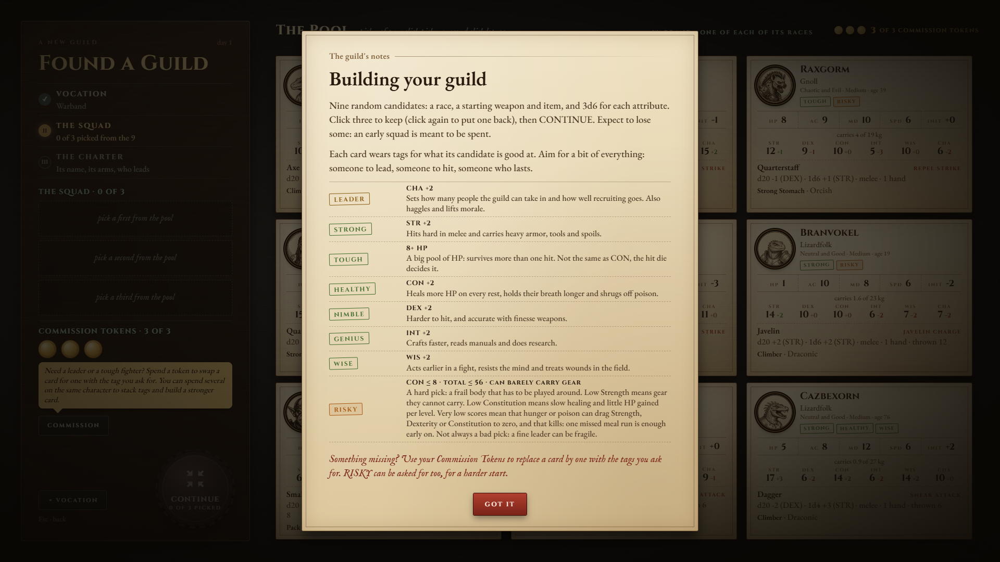
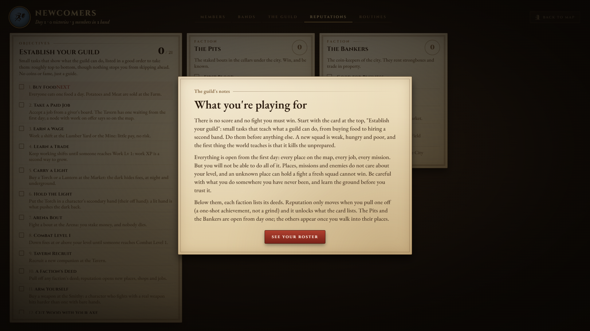
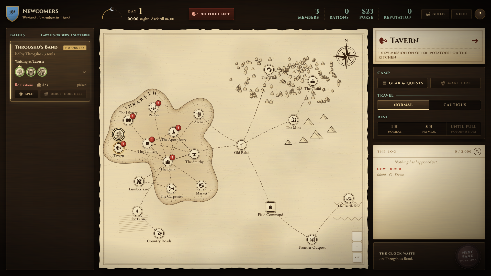
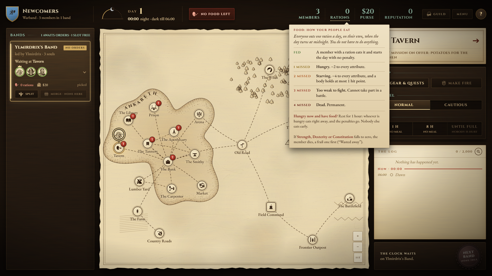

# Onboarding: a first season that is played, not read

How a new player is brought into the game. Written 2026-11-13 from four sources: every tutorial card and
objective in `locales/en.json`, the play recorder's logs in `recordings/` and `saves/`, a fresh guild played
through the real server in headless Edge, and the playtest notes in [backlog.md](backlog.md).

This is a proposal. Nothing here is built except the script that measures it
(`scripts/onboarding_report.py`). The calls that are the author's are listed at the end.

## The short version

The game has three problems at its start, and only the first is "too much text":

1. **Delivery.** The game teaches with 48 modal cards (about 4,500 words). A new player closes 7 of them
   (877 words) before giving the first order. The one outside tester read none of them.
2. **Direction.** The goals live on a tab the player is shown once (Guild, Reputations). The map, where
   the player lives, shows six identical `!` marks and no next step.
3. **Nothing to do at level 0.** A new squad has one income, the Lumber Yard, at about 1 copper a member a
   day after food, and every text tells it to be afraid and to work. In the recorded runs 79% of the first
   two weeks is wage shifts, and the first job is taken on day 19.

The proposal answers each: short notes at the moment of the decision in place of cards; direction that
comes from the world (a keeper's errand, one `!`) and not from a panel on the map; and a first season of
five short chapters, given by the keepers as small paid errands, that walks the core loop once and ends by
handing the player the tool that retires the grind (a routine).

Author's call, 2026-11-13: the map stays quiet. A step sheet and a "what you can do today" board on the map
are too spoon-fed and were dropped from the first draft of this plan. Direction has to come from the world
and from rare, well-timed hints.

## What was measured

### The text a new player meets

A fresh guild, every card closed in the order the game shows it:

| # | When | Card | Words |
|---|---|---|---|
| 1 | new guild | Welcome to Gartok | 86 |
| 2 | vocation step | Choose a vocation | 44 |
| 3 | squad step | Building your guild (8 tag rows) | 280 |
| 4 | charter step | Identity and leadership | 56 |
| 5 | the map opens | Your guild | 120 |
| 6 | sent to Reputations by card 5 | What you're playing for | 179 |
| 7 | sent to Members by card 6 | Your roster | 112 |
| | **before the first order** | **7 cards** | **877** |
| 8 | enters the Tavern (it opens on Food & Drink) | Buying and selling | 161 |
| 9 | the Recruit tab | Recruiting | 193 |
| 10 | the Jobs tab | Paid jobs | 65 |
| | **before the first job is taken** | **10 cards** | **1,296** |

Cards 5, 6 and 7 come one after the other with no play between them. The first shift then adds the work
card, the level-up card and the talent tree card; the first bout adds the squad card, the battle card (214
words and its rows), the report and the purse.

### What players did

`python scripts/onboarding_report.py recordings saves`, the twelve runs of 14 days or more that were
recorded from day 1 (the author's and the testers', October and November builds):

| | Median | Range |
|---|---|---|
| First job taken | day 19 | day 1 to day 96; two runs never took one |
| First fight | day 10 | day 3 to day 50 |
| First combat level | day 14 | day 4 to day 51 |
| First recruit | day 13 | day 1 to day 71; two runs never recruited |
| Share of the first 14 days' member-hours spent on wage shifts | 79% | 62% to 99% |

Three of the four November runs spent 98 to 99% of their first two weeks at the Yard. One tester's guild
worked shifts for fifty days before its first fight. That is the loop the author describes as "stuck,
nothing to do": the player is not lost for lack of a rule, the player has found the one safe thing and
repeats it.

### Why the Yard

What a fresh guild of three with about $23 can take up on day 1 (`python scripts/economy_offers.py --size 3 --money 23`):

| Offer | Net | Notes |
|---|---|---|
| A 16 h shift at the Lumber Yard | +$3 a day for the squad, after 3 meals | no risk |
| Potatoes for the Kitchen | +$11, once | no risk (added 2026-11-12) |
| The Pit: Scrapper | +$2 on a win, -$9 on a loss | break-even at 82% wins |
| Fifteen Hides, Fifteen Red Mushrooms | $200, $150 | the Wilds, where a level-0 squad normally dies |
| An Axe for each worker | -$35 each | pays back in 35 shifts |

The objectives then ask for a weapon ($35), an Axe ($35), a strongbox ($90), an animal with its saddle and
a wagon ($150). At +$3 a day that is months of shifts. The economy sim's own reference player (`balanced`)
is a sprint to the day-30 milestone before it leaves the Yard, so the stretch is designed; what is missing
is anything to do inside it, and a reason the player can see for doing it.

The copy pushes the same way:

- The objectives' card: "Do them before anything else. A new squad is weak, hungry and poor, and the first
  thing the world teaches is that it kills the unprepared."
- The danger card fires on the first step outside the city's jurisdiction, and the Farm is outside it. So
  the first trip the game itself asks for (the innkeeper's potatoes, "Buy Food") answers with "Out here it
  is dangerous", a row "Work at the Lumber Yard" and a row "Train at the Arena". The card is then spent
  and does not show when the band first walks the Old Road, the one node that rolls an ambush.
- Three objectives and the work card repeat that work makes a character stronger.

Routines, the game's own answer to repeated work, need a seat, and `routine_book.BASE_SLOTS` is 0: the
first seat comes at 6 fame (`routine_book.FAME_PER_SLOT`). The late save in the photo review had 7 fame on
day 73.

### Smaller findings from the playthrough

- The game opens at 00:00 on day 1, in the dark, with zero or one ration and a red alert in the header.
  Nothing on the map says where food is sold; the Farm has no mark.
- Six nodes wear the same `!` on day 1 (new faces, a job on offer). The Tavern's is the one that matters.
- The Tavern opens on its shop tab, so the player who came for the job reads the shop's card first.
- The draft offers candidates with 1 and 3 hit points with no word on what that means in a fight. The
  tester learned the draft the wrong way.
- The objectives number 21 in one flat list, a five-minute task beside a fifty-day one, with no place to
  click and no reward.

### What is told, and what is not

| System | Told today | When the player needs it |
|---|---|---|
| Meals, hunger | map card, roster card, road hint, an alert | day 1: told four times, all as text |
| Food spoils | not told (the shelf shows days left) | the first purchase: the tester lost his food to it |
| The clock runs on orders, and stops for you | map card, one sentence | the first order |
| Day and night, light | two objectives | the first night fight or delve |
| Rest and healing | not told | the first wound |
| Money lives on each character | purse card | the first reward |
| Spending the last coin | not told (author's note in the backlog) | the first time the purse cannot buy a day of food |
| Languages (trade, recruiting, talks) | inside the recruiting and talk cards | the first failed pitch, the first shop that does not speak yours |
| The recruit pool turns over weekly | recruiting card (author's note in the backlog) | when nobody in the pool can be recruited |
| Carry weight, item sizes | not told | the first purchase that does not fit |
| Action points, Defend, Delay | battle card; Delay not told | the first turn: the tester learned Delay the wrong way |
| Morale and fleeing | not told | the first rout |
| Flanking, reading a foe, a fallen member | hints, at the moment | good: these are the model |
| Where it is dangerous | the danger hint, at the Farm | the Old Road and the Wilds |
| Talents and hit dice | talent tree card | the first level |
| Fame, group slots, routine seats | The Guild tab's card | when the second band is wanted |
| Routines | the Routines tab's card | when the same order has been given by hand for a week |
| Deeds and what reputation opens | objectives card | after the first deed |

The hints (`hints.on_map`, `hints.in_battle`) are the part of the system that already works the right way:
one rule, fired by the event that makes it matter, with a way to the wiki.

## Principles

0. **First, the player must know the rules, not just how to play.** The point of the onboarding is less
   "how do I click" than "why are things the way they are": when people eat, what a missed meal costs,
   what the clock does, what death is. Each rule the game runs is stated, with its real numbers, where
   the player meets its consequence (author, 2026-11-13). The rules table above is the audit of this: a
   rule with no row is a rule the player is not told.
1. **The rule is shown where the decision is made** (the playtest's own theme, 2026-10-31): on the pick,
   the price, the button. A card on entering a screen is the opposite.
2. **One idea, one action.** A note names one thing and what to press. Its budget is 30 words; a card
   that needs more is a wiki entry.
3. **The world points, a panel does not.** A keeper with an errand and one `!` say what is next; the map
   carries no step list and no "do this now" (author, 2026-11-13).
4. **Doing teaches.** A step is done by doing it in the real game. No practice level, no scripted fight.
5. **A grind the player chose is not a grind.** What is being saved for, and how far along it is, is on
   screen.
6. **Nothing is locked.** The sandbox stays open; the season is a path drawn on it, and it can be put away.
7. **Nothing is seen only once** (author's worry, 2026-11-13). Every rule the player is shown at a moment
   has a permanent home they can go back to: the screen's `?`, a hover, or a wiki entry. Today a screen's
   card is safe (its `?` reopens it forever, `TutorialState.reopen`), but a hint is not: once closed, it
   is never shown again, and its only way back is the "See in the wiki" button inside it. So:
   - **A card that becomes pointers keeps its text behind the `?`.** It stops opening by itself; the `?`
     still opens it as that screen's reference. No card text is deleted by this plan.
   - **Every hint has a wiki entry**, and the hint is listed again under the `?` of the screen it fired on
     ("Rules met here": each hint seen on the map or in a fight, reopenable). Today the danger hint has no
     wiki entry at all (`hints.wiki_ref` has no row for it).
   - **A pop-up on hover is permanent by nature** (the RATIONS pop-up), so it needs nothing more.
   The audit ([onboarding_audit.md](onboarding_audit.md)) has a column for this: where each rule can be
   read again.

## The proposal

### 1. The map stays quiet; the world gives the direction

A first draft put a step sheet and a "what the guild can do today" board in the map's Bands column. The
author rejected it as too spoon-fed. What replaces it is smaller:

- The objectives stay on Reputations, regrouped into the five chapters of section 2, so the list reads as
  a path and not as 21 flat items.
- Direction is the keeper's `!`, and the offers arrive over the first weeks instead of all at once (author,
  2026-11-13). On day 1 only the Tavern stands out, because it has both recruiting and the innkeeper's job.
  The other places do not carry a mark yet, not because the Tavern is "first" but because their offers have
  not come in: a job appears on day 3, another on day 5, and so on, so the player sees the world fill up and
  can organise around each new mark. A map where every building is covered in `!` on day 1 loses the
  player. The mechanism already exists: a mission has `min_day` (`missions.MissionTemplate`) and
  `offers_at` honours it, so this is data (a day on each early mission, and the new-faces mark of the other
  recruiting places held back the same way), not a new system. Which days, and which keeper gives which
  errand, is an economy-and-content call to make with the chapters of section 2: a chapter's errand is the
  mark that arrives when the chapter before it is about done.
- The first-minute notes of section 3 are the rest: a pointer, not a list.
- A stall (section 4) is answered by one rare hint, not a standing board.

The map's one existing visual piece, the brass ring on a place the step is about, is dropped too.

### 2. The first season: five chapters

The 21 objectives become five chapters of two to four steps, in the order the systems are needed. Each
chapter is given by a keeper, as the innkeeper's potatoes already are, and pays a little. Days are what a
player following the steps should reach, not limits.

| Chapter | Steps | Teaches, each at its moment | Today |
|---|---|---|---|
| **I. Eat** (day 1) | Take the innkeeper's job. Buy 3 Potatoes at the Farm, and supper. Bring them back. | a place and its tabs; travel and the clock; the shop; meals and spoiling; a job's reward goes to a character | the job exists; "Buy Food" and "Take a Paid Job" exist |
| **II. Earn** (days 1 to 2) | Work one shift at the Yard. Spend the first talent pick. | an order takes hours; the wage; work XP; the talent tree | "Earn a Wage", "Learn a Trade" exist; the pick is a new check |
| **III. Fight** (days 2 to 4) | Fight a bout in the Pit. Win one. See to the wounded. | the board, with the notes of section 3; a deed and what reputation is; rest and the Medic | "Arena Bout", "A Faction's Deed", "See the Medic" exist; rest is a new check |
| **IV. Grow** (days 4 to 10) | Recruit a fourth. Buy one real weapon. Reach combat level 1. | the pitch, language and alignment; saving for a price; levels | all three exist |
| **V. Venture** (days 10 to 20) | Carry a light. Take one errand past the walls. Leave a worker at the Yard on a routine. | light; the road's ambush and the talk before a fight; splitting a band; routines | the light and the split exist; the errand and the routine step are new |

After chapter V the list on Reputations says the guild is established. The rest of today's list (the Axe,
the licence, the strongbox, the animal, the wagon, bail, initiation) stays there as things a guild can do,
not as steps: they are choices, and at the Yard's pay they are months away. Nothing is pinned to the map.

What is new content, and needs the author's numbers:

- **A reward on chapters II to V.** Today the objectives pay nothing by design. The proposal is small pay
  from the keeper who gives the chapter, in kind where it teaches: the Pit waives the stake of a guild's
  first bout (a loss on day 2 costs a third of the purse today); the foreman's first full shift pays a
  bonus; the smith takes a few copper off the first weapon. The sizes are an economy decision
  (`python scripts/economy_report.py` after any of them).
- **One errand a level-1 squad can do past the walls** (chapter V). Every job past the potatoes is in the
  Wilds or across the whole map. A delivery between two keepers over the Old Road, paid about a week of
  wages, would teach the travel preview, the ambush roll, the talk and fleeing in one trip.
- **The first routine seat as the season's last reward.** The player has given the Yard's order by hand
  for two weeks and is handed the thing that gives it for them. It turns the grind into the lesson for
  the game's most distinctive feature. Today the first seat costs 6 fame.

### 3. Notes in place of cards

Three kinds of teaching replace the card on entering a screen. The long text is not thrown away: the
card stays behind the screen's `?` as its reference (principle 7), and stops opening by itself.

| Kind | What it is | Budget | Blocks the screen |
|---|---|---|---|
| **A pointer** | one sentence beside the thing to press, gone when it is pressed | 15 words | no |
| **A margin note** | the screen's one rule, written by hand in its margin, there until folded | 30 words | no |
| **A hint** | today's `hints.py` cards: a rule fired by its event, with "See in the wiki" | 40 words and up to three rows | yes, once |

The card already knows how to light a part of the screen (`tutorial_spot`, a row's `focus`); a pointer is
that without the veil. The art direction already asks for "a hand-written note in the margin where a hint
sits today".

The first session rewritten this way, as an example of the size:

| Today | Proposed |
|---|---|
| Welcome, 86 words | kept: it is the premise, read once, and it is short |
| Choose a vocation, 44 | margin note: "One perk for every member, and the six races of your draft. It cannot be changed." |
| Building your guild, 280 | pointer on the pool: "Pick three: one to lead, one to hit, one who lasts." The tags explain themselves on hover; a card with 1 to 3 hit points says "falls to any blow" |
| Identity and leadership, 56 | pointer on the leader row: "The leader haggles and recruits. Pick the best Charisma." |
| Your guild (map), 120 | becomes the premise card (about 60 words: no score, weak start, the world ignores your level, death is permanent, everything open) with its button to Reputations; how to use the groups and the clock become pointers, each done by doing it |
| What you're playing for, 179 | cut to the one paragraph on deeds (a one-shot, not a grind); the rest moved to the premise card (see the table above) |
| Your roster, 112 | leaves the founding chain; the hunger ladder is a pop-up on the RATIONS number, the attribute loss and attribute-zero death are a hint the first time the guild is low on food, the roster's buttons are pointers on its first visit |
| Buying and selling, 161 | pointer: "Click a row, then BUY." Haggling, selling and what each shop stocks are margin notes and the wiki |

New hints, each fired once by its event (the first three are already wanted in the backlog's notes):

- the purse can no longer buy a day of food;
- nobody in the Tavern can be recruited (no shared language, or every pitch spent): "new faces next week";
- a stack bought with a day or two of shelf life left, and the first food that rots;
- a wounded member and no rest ordered;
- night falls with no light in any hand, outside a town;
- a pack over its load;
- a level-up pick left unspent for a day;
- the Old Road chosen as a destination or a way through, on the travel preview (the danger hint moves
  here from the Farm);
- the fifth day in a row of nothing but shifts (section 4).

#### The fight, action by action

The battle panel builds its buttons from `PANEL_ACTIONS`: 35 combat actions and 23 utility ones, most of
them tied to a weapon, a talent or a race, so no two squads see the same bar. A card cannot list them. The
card today (the battle card, 214 words and two rows) tells the player the action points, the bar, the seal,
moving and attacking, what sight is, what the `?` fields are, and that a character at 0 HP is down. The
second fight's reading hint (`hints.READING`, which fires once `guild.battles_won >= 1`) is the author's
Assess lesson and stays. Nothing tells the player about Delay, Flee, Demoralize, Push, Non-lethal, Draw,
Throw or Reload.

- **The first fight** (author, 2026-11-13): move, attack, end the turn, nothing else, as pointers on the
  first turn and not a card, and the two shortcuts with them, because they are the fast way to play:
  **double click a foe attacks it** (the first click marks, the second strikes) and **Space defends and
  ends the turn** (Defend first if the character can afford it, then the turn ends). Both exist today as
  rows of the battle card (`tutorial_rows`, "Double click" and "Space"); they become the second and third
  pointer. One rule that bites at once rides along as a single sentence, the action points ("a turn is N
  points; an attack costs 1").
- **The second fight:** the Assess hint, as now.
- **Every other action: a `!` on the button, raised by a foe using it.** When an enemy uses an action
  the player has never seen, the button for that action on the player's bar carries a `!` until it is
  hovered. If the button is on another tab (combat or utility) the `!` sits on that tab, and if it is
  past the overflow arrow the `!` sits on the arrow, so the mark is never hidden (author, 2026-11-13).
  The hover plate already shows the name, the cost and the rule, so the mark is all that is missing: one
  mechanism covers all 58 and the actions a future weapon adds, with no card to write. The plate's text
  must state the rule with its numbers (principle 0), which is a review of the action texts, not code.
  The same `!` is raised when a character is first given an action (a weapon's trait, a talent, a race
  ability), so the player's own new options are marked too.
- **When the foe uses an action the player has not got on the bar** (a Dragon Breath, a Tail Sweep): there
  is no button to mark. The action's name in the chronicle line becomes the hover: it shows the action's
  wiki entry (the same text the hover plate and the wiki's Actions chapter hold, with its cost and rule),
  and the first time carries the `!`. One text in one place, no second plate. If the chronicle's lines
  cannot take a hover today, making the action's name in them hoverable is the work; there is no
  fallback through the foe's sheet (author, 2026-11-13).
- **Event hints for the rules that surprise** (each once, each with a wiki link): the turn ended with points
  unspent and Defend affordable (what Defend does); the first time a member is low enough that the
  morale check can make a unit run (Flee, and what a rout is); the first foe at low HP when a captive is
  worth something (Non-lethal). **Delay** (author, 2026-11-13): fires the first time a character spends both its points
  walking. Delay only works before a point is spent ("drop to the end of the order, once a round"), so
  the hint cannot say "press it now": it says what Delay is and that next turn, to let others act first,
  it must be pressed before moving.

### 4. A stall gets one rare hint, not a board

A first draft listed "what the guild can do today" on the map. The author rejected it (too spoon-fed).
What stays is the cheapest part of it: the game can notice a stall, and says so once.

- Five days in a row of nothing but shifts, while a job or a bout is affordable, fires one hint that names
  the one offer. It is a hint like the other eight: once, closable, with a way to the wiki.
- "Within reach" means three things at once: the guild can pay for it now, it is not deadly for the
  squad's levels, and the place can be reached before its deadline. A job in the Wilds for a level-0
  squad is never named, so the hint never sends a new guild to die.
- "Nothing but shifts" means five days with no accepted job, no fight, no recruit and no purchase of note.
  The hint fires at most once per offer and once per five days, and respects the switch in settings.
- Examples, from `scripts/economy_offers.py` for a guild of three with $40: the innkeeper's potatoes (costs
  $9, pays $20, three hours' walk to the Farm and back); a Scrapper bout in the Pit ($9 stake, pays $11,
  nobody dies); and a first weapon (about $35, the cheapest thing that makes a fight winnable), when the
  purse has reached it.
- To find the offer it needs the same list `scripts/economy_offers.py` builds from the game's tables
  (`all_offers`). That list moving into the game as a rules module is also wanted by the campaign AI's
  planner ([campaign_ai_roadmap.md](campaign_ai_roadmap.md)), so it is built once, but nothing draws it.

### 5. The first minute

- Open at dawn (06:00) with one meal each in the packs (the backlog's note already asks for a Meat in
  each starting kit), so the first thing the player sees is the map and the innkeeper's `!`, not an alarm. Hunger
  arrives on day 2 as the consequence of chapter I, which is when it teaches.
- The Tavern opens on Jobs while the innkeeper's job is on offer and untaken.
- The draft marks three candidates as a suggested squad (a leader, a hitter, one who lasts), which the
  player may ignore. It turns nine statblocks into a yes or no for a first-timer.

## The rules the first cards carry, and where each one goes

The founding chain (the map card, Reputations, the roster) is the only place today that says the world is
dangerous, that the squad is weak, how hunger kills and that death is permanent. Cutting the chain must not
cut those rules. Each one gets a home, and the first three stay in front of the player on day 1:

| Rule (today's card) | Where it goes | Moment |
|---|---|---|
| There is no score and no fight you must win; death is permanent and the run ends only when the whole guild is gone (roster, Reputations) | **The premise card**: the map's first card, rewritten to about 60 words and no more. It keeps its button, so the player still walks to Reputations by it | the first minute, once |
| A new squad is weak and poor; places and enemies do not care about your level; an unknown place can hold a fight you cannot win; learn the ground first (Reputations) | same premise card (two of its sentences). The Old Road hint repeats it when the player first picks a way out of the walls | first minute, and the first dangerous trip |
| Everything is open from day 1 (Reputations) | same premise card, one sentence | first minute |
| Where the goals are: "Establish your guild" at the top of Reputations, deeds below (map card, Reputations) | the premise card's button opens Reputations, and its card is cut to the one paragraph that is not obvious: a deed is a one-shot, not a grind. The chain stops there and does not continue to the roster | first minute, then Reputations |
| Hunger's ladder: hungry, starving, too weak to fight, dead on the fourth day (roster) | a **pop-up on the RATIONS number** in the top bar (opens on hover or click, and the number is dotted-underlined to say so), that first says when people eat (each member eats one ration by themselves when the day turns at midnight, own pack first and then the group's, and the player does nothing) and what the rest button does about it (a rest of any length, even 1 hour, makes whoever is hungry eat right away; nobody else eats early), then lists the four days with their real effects: hungry is -2 to every attribute, starving is -4 and a body holds 1 hit point at most, day 3 too weak to fight, day 4 dead. The values come from `unit_hunger.HUNGER_PENALTIES` and `STARVING_HP_MAX`, never typed into the text. It opens by itself the first time the guild is low on food. Mock:  | any day, and the first low on food |
| Hunger also drops Strength, Dexterity, Constitution, and a character at zero dies, a frail body first; the log reads "Wasted away" (roster) | a **hint** fired the first time the guild is low on food (`guild_upkeep.Guild.food_alert` returns a level: a day of rations or less), before anyone is hungry, with the wiki link. It says what an unfed day costs: attributes drop, and Strength, Dexterity or Constitution at zero kills. Author's call 2026-11-13. It is the player's warning, not a post-mortem | first "low on food" |
| Death is permanent, and what happens to the dead's pack (roster) | the existing `fallen` hint, which already fires on the first fall; add one line to it | first death |
| Roster mechanics: click for the sheet, MANAGE GEAR, SHARE RATIONS (roster) | pointers on the Members tab the first time it is opened | first visit |

Two things this means for the order of play: the player reads one 60-word card (the premise), then
Reputations (one paragraph), then plays. The roster card is the only one of the three that leaves the
founding chain, and its rules are in a note that is on screen, not in a card closed on day 1.
Hunger and death are the most important rules in the game's early hours, so they are the two with the
most places to be seen.

## The ledger: everything the player is taught, in the order they meet it

One list to track all of it. "Today" is what the game does now (48 cards, word counts from
`locales/en.json`); "Proposed" is this plan. A card is a modal; a pointer is a line beside a control; a
note is text in a margin; a pop-up opens on hover; a hint is a card fired by an event.

**A. Creation, before the guild exists** (all stay)

| Moment | Today | Proposed |
|---|---|---|
| New guild | card, 86 words | stays |
| Vocation step | card, 44 | stays |
| Squad step | card, 93 plus 8 tag rows | stays; suggested trio and tags on hover are later |
| Charter step | card, 56 | stays |

**B. The first minute (Found Your Guild, then the map)**

| Moment | Today | Proposed |
|---|---|---|
| The map opens | card, 120, "See your objectives" | the premise card, about 55 words, same button |
| The button | Reputations card, 179 | cut to the deeds paragraph, about 45 |
| Closing it | chains to the roster card, 112 | back to the map; no chain |
| The map, day 1 | six `!`, the alert, no direction | one `!` on the Tavern; the others arrive by `min_day` |
| The top bar | RATIONS is a number | RATIONS pop-up (mocked); first-low-on-food hint |

**C. The first day**

| Moment | Today | Proposed |
|---|---|---|
| Enter the Tavern | shop card, 161, then the Tavern card, 193, then Jobs, 65 | opens on Jobs; one pointer; the rest in margin notes and the wiki |
| Walk to the Farm | the danger card, 123 words, wrongly | nothing |
| Buy and carry food | none (spoiling is nowhere) | a hint if the food is perishable |
| Night falls, no light | nowhere | a hint |
| First wage shift | work card, 65, level-up 27, talents | a pointer on the result; a hint when a pick waits a day |

**D. The first fight**

| Moment | Today | Proposed |
|---|---|---|
| The squad card | 55 | a pointer |
| The battle card | 197 plus rows | three pointers (move, double click, Space) and the points sentence |
| First time both points are spent walking | nowhere | the Delay hint |
| First member down | the fallen hint, 38 | stays, one line longer |
| After the fight | report 33, loot 49, reward 15, memorial 15 | one pointer each; the card stays behind the `?` |

**E. The second fight and after**

| Moment | Today | Proposed |
|---|---|---|
| Second fight | the reading hint, 62 | stays |
| An enemy uses an action not yet seen | nothing | the `!` on the button, tab or arrow, or on the chronicle line |
| A flank | the flank hint, 140 | stays, cut to about 60 |
| Low on food, first time | an alert | the hint (attributes, zero kills) |
| Hungry, wounded, over the load, no light | nowhere | one hint each |
| Five days of nothing but shifts | nothing | the stall hint |
| Old Road chosen | the road hint, 44 | stays and gains the danger text |

**F. Places met later** (one card each today; each gets a margin note, and the card stays behind the `?`)

market 161, taverna 193, hunt 59, bank 78, level 65, library 50, group 73, missions 65, trust 39,
ledger 29, craft 127, medic 94, property 63, claim 112, guard 60, dialogue 60, prison 45, stable 88,
wagon yard 95, watch 79, garage 77, gathering 138, initiation 118, group turn 68, guild overview 56,
routines 104, band routine 84, study hint 58, dungeon hint 57, place hint 43, wilds hint 123. The combat
lab card (122) is not part of a new game and does not change.

Of 48 cards, 4 stay as they are, 1 is rewritten (the premise), 1 is cut to a paragraph, 1 leaves the
chain, 8 stay as hints, and the rest become pointers and notes over the order of work below. When a row
is built, its line here is crossed off and its text lives in `locales/en.json`.

## Audit: every rule the game runs, and whether the player is told

The game's own wiki (the Rules chapter, `wiki_rules.sections`) has 17 entries: Turns and Action Points,
Off-guard and flanking, Morale, Weapon Actions, Talking Before a Fight, Recruiting, Groups Leaders and
Fame, Captives, Wagons and Animals, Money Food and Death, Hunger and Starvation, Clean Stomp, Poison,
Studying, Dungeons, Placing the side, Reading a foe. `RULES.md` documents about 60 systems. A rule can be
told at the moment (a hint or a pop-up), told in a card the player closes, only in the wiki, or nowhere.
The status below is read from the cards, the hints and the wiki as they are today; each row is to be
checked against the screen when its note is built.

**Time and the body**

| Rule | Told today | Proposed home and moment |
|---|---|---|
| Everyone eats once a day, by themselves, at midnight | a card on the Members screen | the RATIONS pop-up (mocked) |
| What a missed meal costs; rest eats the hungry | a card; wiki | the RATIONS pop-up; the first low-on-food hint |
| The clock only moves when a band has an order; it stops when one needs you | one sentence in the map card | a pointer on the clock the first time it stops by itself |
| Day, night, light: what you see and what the dark costs | two objectives; wiki only for sight in battle | a hint when night falls with no light in hand; the pop-up on the day/night dial |
| Rest and healing: how fast, what it costs, what a Medic does | not told | a hint on the first wounded member; hover text on the rest buttons that says hours and meals |
| Food spoils | nowhere (the shelf shows days left) | a hint on the first perishable bought; the days-left shown in the shop's row |
| Sickness and poison | wiki entry only | a hint on the first poisoned or sick member |
| Death: permanent, the dead's pack stays on the field | a card | the `fallen` hint, which already fires |
| Carry weight and item sizes | not told | a hint on the first pack over its load, and a pointer on the load bar |

**Money and work**

| Rule | Told today | Proposed home and moment |
|---|---|---|
| Money lives in each character's pack; there is no guild purse | a card | a pointer on the PURSE number (the pop-up lists who holds what) |
| A shift pays by the hour and levels a work track | the work card | a pointer on the first shift's result |
| Combat levels, hit dice from every track, the talent pick | the level-up and talent cards | a hint when a pick is waiting a day |
| Haggling and what a shop will buy | the shop card | margin notes in the shop |
| Prices differ by place and by who is selling | nowhere | a note on the first sale |

**People**

| Rule | Told today | Proposed home and moment |
|---|---|---|
| Recruiting: the pitch, the pool turns over weekly | a card (193 words) | a pointer on the pitch and a note when nobody can be recruited |
| Languages: who can trade, recruit and talk to whom | inside the recruiting and talk cards | the failed pitch says which language is missing |
| Alignment and what it changes in a pitch | the draft card | a note on the pitch |
| Leaders, groups, splitting and merging, fame and slots | the Guild card and a pop-up | a hint when the second band is wanted and no slot is free |
| Morale and fleeing | wiki and no card | the Flee hint in the fight |

**The fight**

| Rule | Told today | Proposed home and moment |
|---|---|---|
| Points, move, attack, end turn | the battle card | pointers on the first turn, and the two shortcuts |
| Double click attacks; Space defends and ends the turn | rows of the battle card | pointers on the first turn |
| Reading a foe, the `?` fields, Assess | a hint on the second fight | stays |
| Flanking, off-guard | a hint | stays |
| Delay | nowhere | a hint when a character first spends both points walking |
| Defend, Flee, Demoralize, Push, Non-lethal, Throw, Draw, Reload | the plate on hover only | the `!` on the button, on the tab or on the arrow; for a foe's action the player does not have, the chronicle line |
| A fallen member, bleeding out, Stabilize | a hint | stays |
| Talking before a fight | a card | a pointer on the first talk |
| Placing the side, walking out of a dungeon | two hints | stay |

**The world**

| Rule | Told today | Proposed home and moment |
|---|---|---|
| Danger by place; the Old Road's ambush | a card at the Farm, wrongly | the Old Road hint |
| Reputation, deeds, what they open | the objectives card | the deeds paragraph on Reputations and a hint on the first deed |
| Missions: offers, deadlines, what a failure costs | the Jobs card | a pointer on the deadline; a hint on the first one that lapses |
| Routines and what a seat costs in fame | the Routines card | the season's last chapter |
| Crime, the Prison, bail, a record that fades | a card | a hint on the first offence |
| Properties, the Claim, the bank vault | one card each | a margin note in each; the late cards |
| The Champion of the Pit and the defence | a card | a hint the day a defence is due, already an alert on the map |

The rows marked "nowhere" or "not told" are the work this audit exists for: food spoiling, rest and healing,
carry weight, light and the clock stopping, and Delay. They are the rules the player breaks without
knowing there was a rule, and they are in the order of work below as hints, one at a time.

## What happens to the 48 cards

| Cards | Become |
|---|---|
| Welcome | stays a card |
| The other draft cards, the map, the shop, work, the squad, loot, report, purse, level-up | pointers and a margin note; the card stays behind the screen's `?` |
| How far the guild reaches | a margin note and the wiki |
| The battle card | three pointers on the first turn (move, strike, end the turn), the standing-actions rows as a margin note; Delay gets a hint the first time a unit ends a turn with points unspent |
| The eight hints | stay, with the danger hint moved to the Old Road |
| The place cards met late (bank, craft, medic, property, garage, claim, stable, wagons, initiation, prison, library, gathering, routines, watch, guard, talk, hunts) | a margin note each, the card behind the `?`; they are met one at a time by a player who already knows the game, so they are the last to convert |
| The combat lab | unchanged (not part of a new game) |

The settings keep their switch; it then turns the pointers and notes off, and "show again" brings them back.

## Order of work

Each phase stands alone and can be judged in a playtest before the next.

1. **Stop the push to the Yard (small, copy and two triggers).** Move the danger hint to the Old Road.
   Cut "do them before anything else" and the repeated "work makes you stronger". Open the Tavern on Jobs.
   Start at dawn with a meal. No new system.
2. **The quiet first minute (small to medium).** `objectives.py` regrouped into the five chapters on
   Reputations; the map's first card is rewritten as the 60-word premise card and still opens Reputations
   (cut to its deeds paragraph); the roster card leaves the chain, with its hunger ladder moved to a note on
   the RATIONS pop-up in the same phase, so no rule is lost; on day 1 the innkeeper's `!` is the mark that
   is the only mark, the next ones arriving by `min_day`. The first minute goes from 411 words in three chained cards to about 120 in two.
3. **Pointers and margin notes in the shell, then the first session's cards (medium).** The two pieces in
   `shell.js` beside the card, and the conversion of the cards of the first hour: draft, map, shop, work,
   squad, battle, report. The late cards follow one screen at a time.
4. **The new hints (small, one at a time).** Each is a trigger in `hints.py`, a key in `locales/en.json`
   and a test, as the eight are.
5. **The stall hint (small).** The offers list as a rules module and the one hint that uses it.
6. **The season's rewards, the errand and the first routine seat (author's numbers first).** Then the
   economy report and the balance tests.

No new screen is drawn in these phases, so no mockup is owed; the pointers and margin notes of phase 3 are
a new kind of element and get one (`docs/web_ui/web_client.md`).

## Exit test

Read from `scripts/onboarding_report.py` over the runs of the next playtest, against today's medians:

| | Today | Wanted |
|---|---|---|
| First job taken | day 19 | day 1 |
| First fight | day 10 | by day 3 |
| First recruit | day 13 | by day 7 |
| Wage shifts in the first 14 days | 79% | under 50% |

And one thing the recorder does not write yet: a row when a card, a pointer or a hint is shown and when
it is closed. The time between the two says whether it was read, which today is a guess.

## Decisions that are the author's

1. **Do the chapters pay?** The objectives were made to pay nothing. The recordings say a level-0 guild
   has too little to do and too little to do it with; small pay in kind is the lightest answer. The other
   is to leave the pay and raise what a level-0 squad can earn elsewhere.
2. **The first routine seat at the end of the season**, or routines stay at 6 fame. It ties to *Routine
   unlocks* in the backlog (blocks as mission rewards).
3. **A free first bout in the Pit.**
4. **One errand past the walls for a level-1 squad**: who gives it, what it carries, what it pays.
5. **Start at dawn with a meal**, or keep the hungry midnight as the opening note.
6. **A suggested squad in the draft.**
7. **How much of the open list stays visible.** This plan keeps everything open and visible on
   Reputations and puts nothing on the map. It ties to *Everything is open from the day the guild is
   founded* in the backlog.

## Considered and not proposed

- **A separate tutorial fight or a scripted first mission.** It teaches a game that is not the one
  played, and the campaign's own first bout in the Pit is already safe.
- **Shorter cards, same system.** The tester did not read short ones either: the problem is the moment,
  not only the length.
- **Locking places until a chapter is done.** It would guide, and it breaks the premise that everything
  is open. A keeper's `!` does the guiding.
- **A step sheet and a "what the guild can do today" board on the map** (drawn in a first draft, rejected by
  the author 2026-11-13 as too spoon-fed).
- **A voiced or filmed introduction.** Cost with no answer to "and now?".
